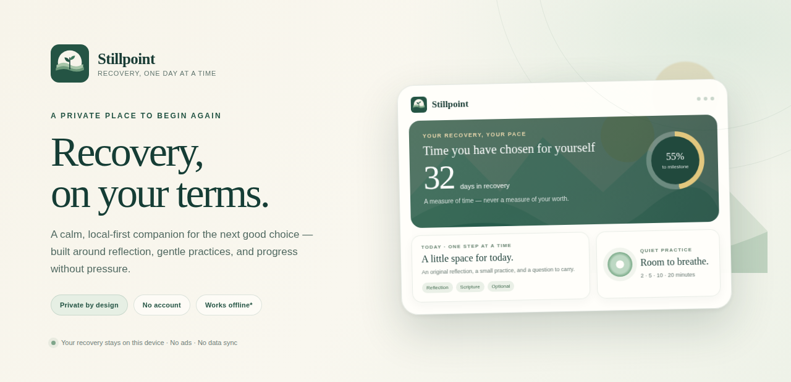
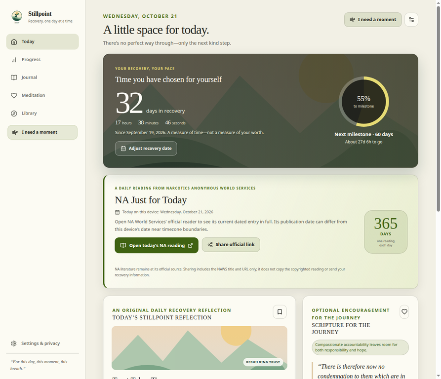
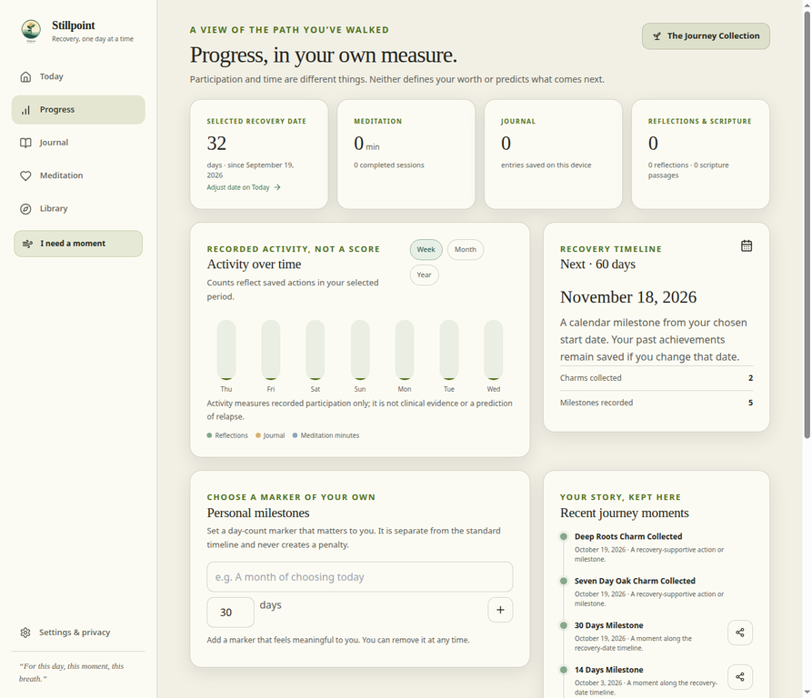
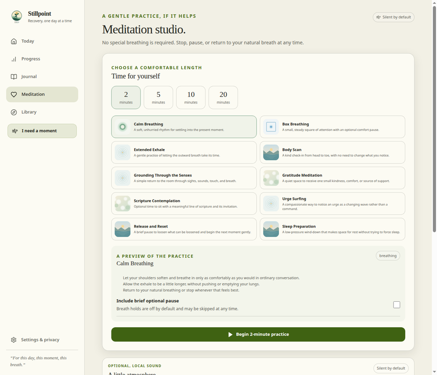
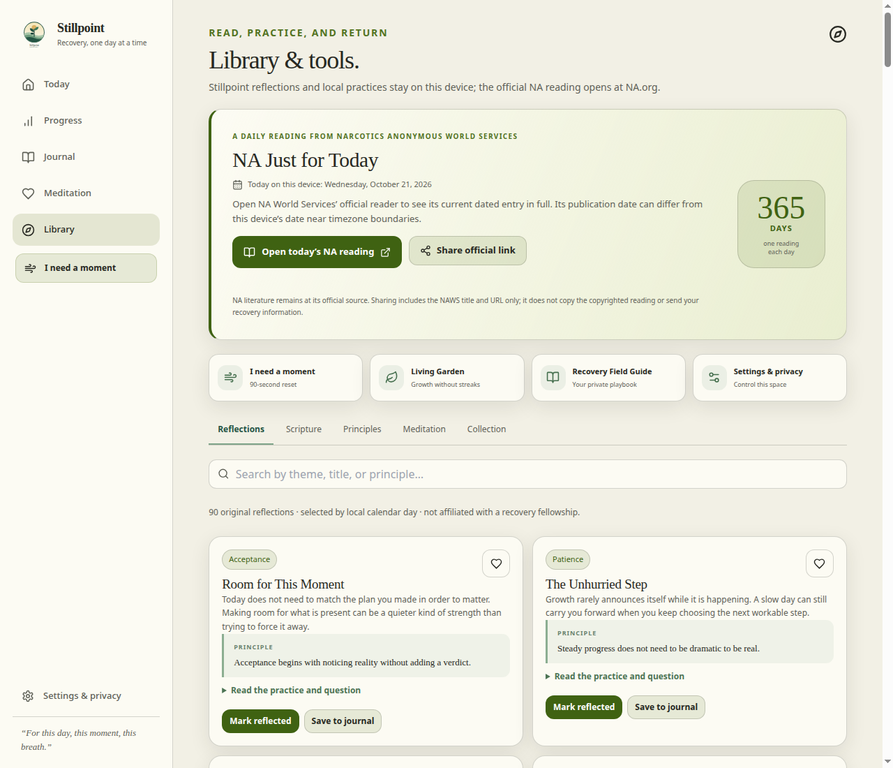
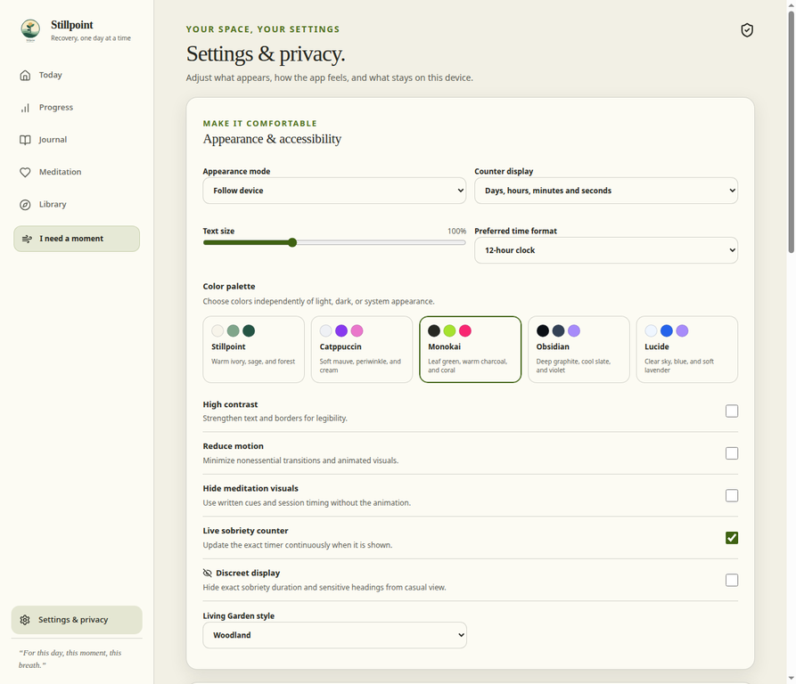
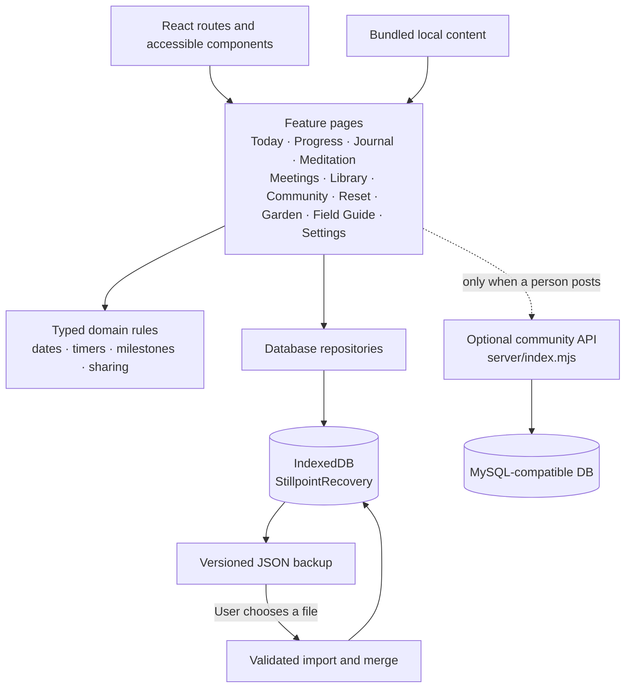

<div align="center">
  
  <h1>Stillpoint Recovery</h1>
  <p><strong>A local-first, privacy-focused, faith-centered sobriety and recovery PWA.</strong></p>
  <p>Daily reflection, gentle meditation, private journaling, and local meeting samples, kept in your own browser. No account. No streak pressure. One day at a time.</p>
  <p>
    <a href="https://stillpointco-lq5mbm5o.manus.space/"><strong>▶ Try the live demo</strong></a>
    &nbsp; · &nbsp;
    <a href="https://stillpoint-recovery-demo.netlify.app/">Netlify demo</a>
    &nbsp; · &nbsp;
    <a href="#screenshots">Screenshots</a>
    &nbsp; · &nbsp;
    <a href="#quick-start">Run it locally</a>
  </p>
</div>

<p align="center">
  <a href="https://github.com/mcochranca-code/stillpoint-recovery/actions/workflows/ci.yml"></a>
  <a href="https://github.com/mcochranca-code/stillpoint-recovery/actions/workflows/coverage.yml"></a>
  <a href="https://github.com/mcochranca-code/stillpoint-recovery/actions/workflows/accessibility.yml"></a>
  <a href="https://app.netlify.com/sites/stillpoint-recovery-demo/deploys"></a>
  <a href="LICENSE"></a>
  <a href="docs/wiki/Home.md"></a>
</p>

<p align="center">
  
</p>
<p align="center"><sub>Screens use illustrative sample values. No personal recovery information is shown.</sub></p>

---

## Why Stillpoint

Recovery is personal. Most tracking apps turn it into a score; Stillpoint makes room for reflection and supportive routines instead. There is no leaderboard, guilt loop, forced streak, or requirement to share your story, and the core app works without an account or a recovery date.

- **Private by default.** Your journal, dates, and history live in your browser's IndexedDB, not on a server.
- **Works offline.** Install it as a PWA; the app shell and bundled content are cached on your device.
- **Gentle by design.** Reduced-motion aware, keyboard accessible, with text scaling, high contrast, and a discreet display.
- **Faith-friendly, never required.** Scripture and Christian extras are opt-in, alongside original reflections and recovery principles.

## Key features

- **Today** — a live, adjustable (or hideable) day counter, an original daily reflection, optional scripture, and a link to the official NA *Just for Today* reading, plus quick shortcuts to a quiet practice, meetings, and the journal.
- **90 original daily reflections** — each with a principle, a small practice, and a question to carry. Written for Stillpoint; not presented as fellowship literature.
- **Private journal** — gratitude, emotions, triggers, coping strategies, prayers, milestones, and free writing, with editing, search, and recoverable drafts.
- **Meditation Studio** — ten gentle practices in 2, 5, 10, or 20 minute sessions, pause and resume, and three bundled soundscapes (rain, woodland, shoreline). Box Breathing follows a highlighted sphere in phase with the cues.
- **90-second Reset, Living Garden, and Field Guide** — a brief grounding flow, non-punitive visual growth, and user-built coping notes.
- **Progress and Journey Collection** — calendar milestones, activity, meditation time, personal goals, and two-sided 3D milestone charms. Editing your recovery date never erases journals, sessions, or earned charms.
- **Meetings** — an offline, source-linked sample of public AA/NA schedules for Stanislaus, Fresno, Mariposa, and Merced counties, plus one Fresno Food Addicts (FA) listing, with on-device filters and an optional map. Coverage is partial; see [meeting sources](docs/meeting-sources.md) and confirm with official directories.
- **Make it yours** — five palettes (Stillpoint, Catppuccin, Monokai, Obsidian, Lucide) and accessibility controls.
- **Backups you control** — export and restore versioned JSON backups on-device, and opt-in milestone sharing that you preview first.
- **Optional community notes** — short, public, date-scoped notes on the day's original reading, only if you choose to post (see [Data and privacy](#data-and-privacy)).

## Screenshots

<table>
  <tr>
    <td width="50%" valign="top">
      <a href="docs/media/today.webp"></a>
      <p><strong>Today</strong> — one moment at a time.</p>
    </td>
    <td width="50%" valign="top">
      <a href="docs/media/progress.webp"></a>
      <p><strong>Progress</strong> — your own measure, not a judgment.</p>
    </td>
  </tr>
  <tr>
    <td width="50%" valign="top">
      <a href="docs/media/meditation.webp"></a>
      <p><strong>Meditation</strong> — gentle by design.</p>
    </td>
    <td width="50%" valign="top">
      <a href="docs/media/library.webp"></a>
      <p><strong>Library</strong> — return to what helps.</p>
    </td>
  </tr>
</table>

<p align="center"><a href="docs/media/settings.webp"></a></p>

<details>
<summary><strong>Optional motion previews</strong> (slow, soft, non-flashing)</summary>
<p></p>
<p></p>
<p>Both are rendered from source-controlled HTML and CSS in <a href=".github/readme-media/">.github/readme-media/</a>.</p>
</details>

## Who it's for

- **People in recovery** who want a quiet daily companion that keeps their reflections private and works without signing up.
- **People of faith**, especially Christians, who want optional scripture and devotional links alongside recovery practice.
- **Members of 12-step and peer fellowships** looking for a link to the daily NA reading and local AA/NA/FA meeting samples in California's Central Valley.
- **Peer supporters and contributors** who value privacy-respecting, accessible, open-source recovery tools.

Stillpoint is a personal reflection companion, **not** medical care, treatment, diagnosis, or an emergency service. Spiritual content and meditation are optional encouragement, never a replacement for professional or peer support.

---

## Tech stack

| Layer | Tools |
| --- | --- |
| UI | React 18, TypeScript, React Router, Tailwind CSS, Framer Motion, Lucide icons |
| Local data | Dexie on IndexedDB (database `StillpointRecovery`) |
| Maps | Leaflet with OpenStreetMap tiles (opt-in) |
| Build | Vite 6, custom precache manifest and service worker |
| Optional API | Node.js + Express 5, MySQL-compatible database via `mysql2` |
| Quality | Vitest, Testing Library, fake-indexeddb, axe-core, ESLint, Lighthouse CI, CodeQL |
| Tooling | Node.js 22, pnpm 11.25.0 |

## Architecture

The core app is a client-side React PWA. Features read and write through typed repositories backed by Dexie/IndexedDB, so **the browser is the system of record**. Static content (reflections, exercises, scripture references, themes, charms, and the dated meeting snapshot) is bundled with the app.



The one networked exception is the optional `/community` route, served by a small Express API in [`server/`](server/) under `/api/community` (plus `/healthz`). It needs a `DATABASE_URL`; without one, local runs keep working and the Community tab reports that hosted notes are unavailable.

<details>
<summary><strong>Project map</strong></summary>

- `src/app/` — application shell, routes, onboarding, and dialog focus management.
- `src/features/` — Today, Progress, Journal, Meditation, Meetings, Community, Library, Settings, Reset, Garden, and Field Guide.
- `src/components/` — reusable interface components and dialogs.
- `src/db/` — IndexedDB schema, migrations, repositories, milestones, and JSON backups.
- `src/domain/` — typed data, date math, sharing, achievement criteria, and domain calculations.
- `src/data/` — reflections, scripture, exercises, charms, palettes, and the dated meeting and coordinate snapshots.
- `server/` — optional account-free community API, database migration, and moderation policy.
- `public/` — brand assets, soundscapes, PWA manifest, and service worker.
- `scripts/` — precache manifest, PWA artifact, coverage, and documentation-link checks.
- `docs/` — [wiki](docs/wiki/Home.md), [architecture decision records](docs/adr/README.md), media, meeting sources, and copyright records.

</details>

## Quick start

Requirements: **Node.js 22** and **pnpm 11.25.0** (pinned in `package.json`).

```sh
git clone https://github.com/mcochranca-code/stillpoint-recovery.git
cd stillpoint-recovery
pnpm install --frozen-lockfile
pnpm dev
```

Open `http://localhost:3000`. `pnpm dev` runs Vite on port 3000 and the community API on port 3001 (proxied at `/api`). Optional setup can be skipped, and no recovery date is required. To install the app, use your browser's **Install app** or **Add to Home Screen** option.

## Scripts

| Command | What it does |
| --- | --- |
| `pnpm dev` | Vite dev server (port 3000) plus the community API (port 3001) |
| `pnpm typecheck` | Strict TypeScript diagnostics |
| `pnpm lint` | ESLint |
| `pnpm test` | Vitest and Testing Library suite |
| `pnpm test:coverage` | Tests plus V8 coverage reports in `coverage/` |
| `pnpm check:coverage` | Per-file thresholds for critical modules |
| `pnpm build` | Typecheck, production bundle, and precache manifest |
| `pnpm verify:pwa` | Manifest, routes, service worker, and precache checks |
| `pnpm preview` | Serve the production build on port 3000 |
| `pnpm start` | Run the community API (`server/index.mjs`) |
| `pnpm check:server` | Syntax-check the server modules |
| `node scripts/check-documentation-links.mjs` | Validate doc links, PDF anchors, and rights references |

## Testing and coverage

Tests cover domain rules (dates, timers, milestones), onboarding, journal create/edit/delete and draft recovery, meditation session state, backup validation and transactional restore, IndexedDB migrations and persistence, keyboard focus, meeting filters, Box Breathing phase positions, and the community API's router and policy.

`pnpm test:coverage` enforces repository-wide minimums set in [`vite.config.ts`](vite.config.ts):

| Statements | Branches | Functions | Lines |
| --- | --- | --- | --- |
| 80% | 70% | 55% | 80% |

`pnpm check:coverage` then applies stricter per-file thresholds to critical modules such as `src/db/backup.ts`, `src/db/repository.ts`, and `src/domain/journal.ts` (see [`scripts/check-coverage-summary.mjs`](scripts/check-coverage-summary.mjs)).

### Continuous integration

| Workflow | Runs |
| --- | --- |
| [CI](.github/workflows/ci.yml) | Typecheck, lint, test, build, and PWA verification |
| [Test coverage](.github/workflows/coverage.yml) | Coverage thresholds and critical-module checks; also weekly |
| [Accessibility](.github/workflows/accessibility.yml) | Lighthouse accessibility check of the production build |
| [Documentation links](.github/workflows/documentation-links.yml) | Link, PDF-anchor, and notice checks; also weekly |
| [Workflow failure notifications](.github/workflows/notify-failures.yml) | Opens or resolves an issue when a workflow fails |
| [Release npm package](.github/workflows/release-npm.yml) | Validates and publishes on a `v*.*.*` tag matching `package.json` |

CodeQL analysis and Dependabot also run on the repository.

## Deployment

- **Netlify (static PWA).** [`netlify.toml`](netlify.toml) builds with `pnpm install --frozen-lockfile && pnpm build`, publishes `dist/`, adds an SPA fallback, and sets security headers (CSP, `X-Frame-Options: DENY`, `nosniff`, referrer and permissions policies) plus no-cache rules for `index.html`, the manifest, and `sw.js`.
- **Docker (community API).** The [`Dockerfile`](Dockerfile) builds on `node:22-alpine` and runs `server/index.mjs` on port 3000.
- **Database.** Set `DATABASE_URL` to a `mysql://` URL that includes an `ssl` query parameter with its TLS settings; it is required when `NODE_ENV=production`. On start, the server applies its schema migration and removes expired notes daily.

The Just for Today card links to the official [NA World Services daily-meditations page](https://na.org/daily-meditations/). NAWS controls the reading and its publication date, which may differ from the device’s local date near timezone boundaries. The app does not rehost or embed the text. With redistribution authorization provided to the repository maintainer, an unchanged archival copy of *Just for Today: Daily Meditations for Recovering Addicts* is available in [`docs/copyright/Just-for-Today-NA.pdf`](docs/copyright/Just-for-Today-NA.pdf). The [daily reflection index](docs/copyright/Just-for-Today-index.md) lists dates, titles, and PDF page links only; it does not reproduce the meditation passages. Full attribution, permission scope, checksum, and non-affiliation language are recorded in [`docs/copyright/README.md`](docs/copyright/README.md).

Library → **NA Step Working Guides** is an in-app reader for *The Narcotics Anonymous Step Working Guides*, shown by permission of NA World Services (see [`CONTENT_SOURCES.md`](CONTENT_SOURCES.md#na-step-working-guides-used-by-permission)). It has a table of contents, resume-where-you-left-off, a reader text size, and an optional private answer box for every question. Answers are stored only in this browser's IndexedDB, are included in the JSON backup and in delete-all, and are never sent anywhere. The reader is reached from Library only; it is not part of the Today card rotation or any nudge. Stillpoint is not affiliated with or endorsed by NA. See NAWS’ [Intellectual Property Bulletin #1](https://na.org/wp-content/uploads/2024/06/IPBUL1-Oct2023.pdf) and [FIPT FAQ](https://na.org/service-material/fipt/fipt-faq/).
The production build creates `dist/`, a web app manifest, a service worker, and a precache manifest. The manifest uses standalone display with shortcuts for **Today**, **I need a moment**, and **Living Garden**. See [PWA and offline](docs/wiki/PWA-and-Offline.md).

## Data and privacy

**Local-first.** Recovery dates, preferences, journals, reflections, scripture activity, meditation sessions, charms, and notes are stored in this browser's IndexedDB. There is no account, cloud sync, or analytics pipeline in the core app, and journal content is never uploaded.

**Excluded from the MIT License: the NA Step Working Guides text.** The guide content in [`src/data/na-step-guides/guide.json`](src/data/na-step-guides/guide.json) (and anything derived from it) is *The Narcotics Anonymous Step Working Guides*, Copyright © 1998, World Service Office, Inc. Reprinted by permission. All rights reserved. It is NA Fellowship-approved literature, used in Stillpoint by permission of NA World Services and **not** licensed to you under MIT. Do not copy, adapt, or redistribute it outside this app without your own permission from NAWS. Permission status and sources are recorded in [`CONTENT_SOURCES.md`](CONTENT_SOURCES.md#na-step-working-guides-used-by-permission).

## Built with
**Local is not encrypted or permanent.** Stillpoint does not encrypt browser storage or exported backups. Clearing site data, removing the browser profile, or uninstalling the PWA may erase saved information. Export a backup regularly and keep it somewhere private. Maintainers cannot recover lost records; only a valid backup can.

**Backups and restore.** Backups are versioned JSON files. Restore previews counts and merges records locally; the profile and preferences replace saved values, duplicate IDs are skipped, and nothing syncs automatically between devices.

**Community notes (opt-in).** Posting sends only a short note (120 characters or fewer) scoped to the day. It never sends your recovery profile, sobriety date, journal, meeting, location, or meditation data. Notes are public, retained for up to 90 days, and deletion keys stay in the posting browser.

**External links and maps.** NA, Our Daily Bread, and meeting-directory links open only when you click them, in a new tab, with no recovery data attached. The meeting map loads OpenStreetMap tiles only after you open it; tile requests reveal the viewed area, not your filters, search text, recovery data, or device location.

**Feedback survey.** Optional feedback goes to a [Jotform survey](https://form.jotform.com/262961231783057), which is subject to Jotform's own privacy practices.

More detail: [Data and Privacy guide](docs/wiki/Data-and-Privacy.md) · [ADR 0001: local-first storage](docs/adr/0001-local-first-storage.md).

## Content and attribution

- **NA *Just for Today*** opens on the official [NA World Services page](https://na.org/daily-meditations/); the app does not copy, cache, or embed the reading. An unchanged archival copy, shared with redistribution authorization to the maintainer, is documented in [`docs/copyright/README.md`](docs/copyright/README.md), and the [daily reflection index](docs/copyright/Just-for-Today-index.md) lists dates, titles, and page links only.
- **Our Daily Bread** links (Reading Plans and the Discover the Word podcast) appear only after choosing Christian under **Settings → Daily readings** and turning on **Show Christian extras**. Stillpoint adds an original prompt and does not reproduce publisher text.
- **Meetings** data is a dated, partial snapshot with sources listed in [`docs/meeting-sources.md`](docs/meeting-sources.md).

Not affiliated with Narcotics Anonymous World Services, Our Daily Bread Ministries, or any fellowship.

## Contributing

Contributions are welcome. Please read [Contributing and Troubleshooting](docs/wiki/Contributing-and-Troubleshooting.md) first. In short:

1. Branch from `main` and keep one concern per pull request.
2. Keep recovery data local by default: no hidden uploads, analytics, or required accounts.
3. Preserve keyboard access, focus, text scaling, high contrast, reduced motion, and discreet mode.
4. Use supportive, non-clinical language, and don't claim encryption, medical efficacy, or outcomes the code doesn't support.
5. Run `pnpm typecheck`, `pnpm lint`, `pnpm test`, `pnpm build`, and the documentation checker before opening a PR.

Deeper docs live in the [project wiki](docs/wiki/Home.md): getting started, architecture, PWA/offline, testing and CI, accessibility validation, and content and licensing.

## License

[MIT](LICENSE) © 2026 Stillpoint Recovery contributors. The license covers the original application source and documentation in this repository. It does not grant rights to bundled or user-supplied media, brand assets, third-party marks, Our Daily Bread or NAWS content, or dependency packages under their own licenses.

<p align="center"><sub>Made for the day you are in.</sub></p>
