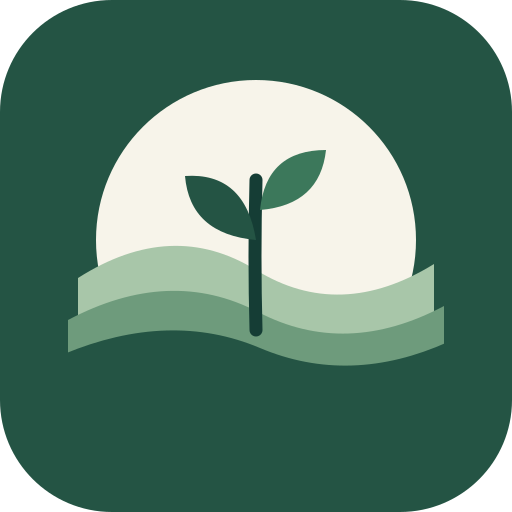
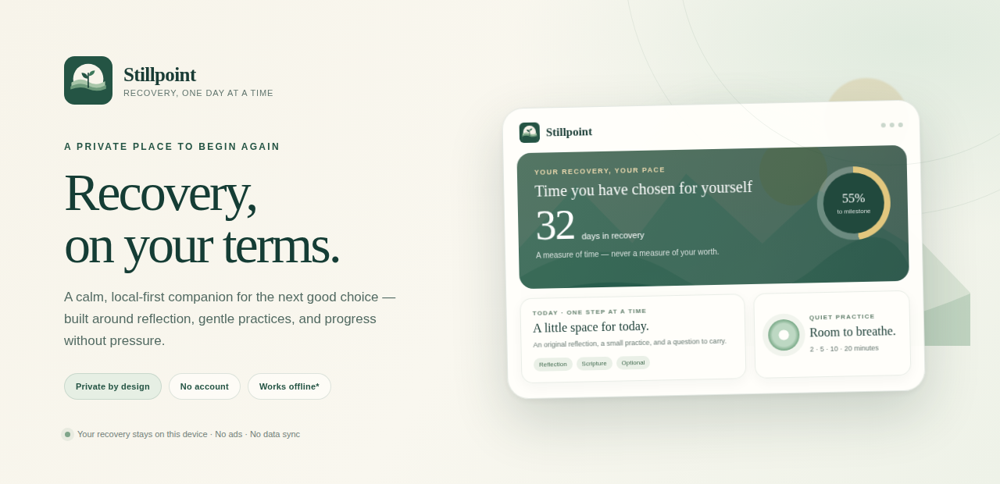
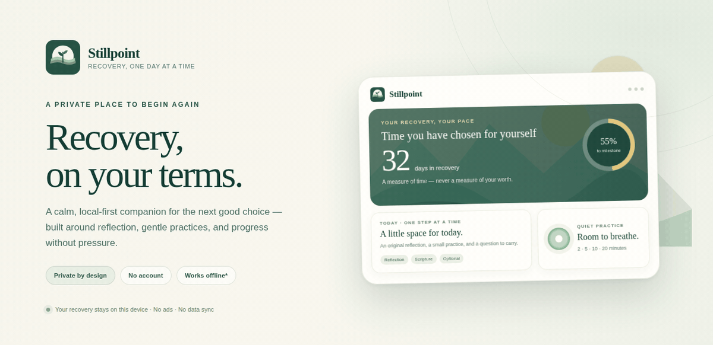
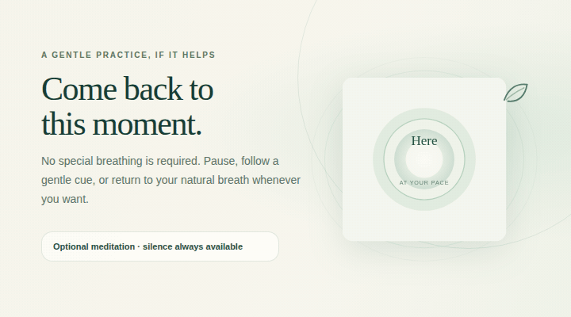
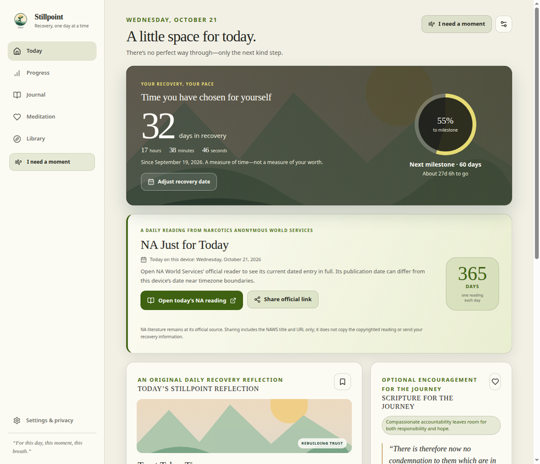
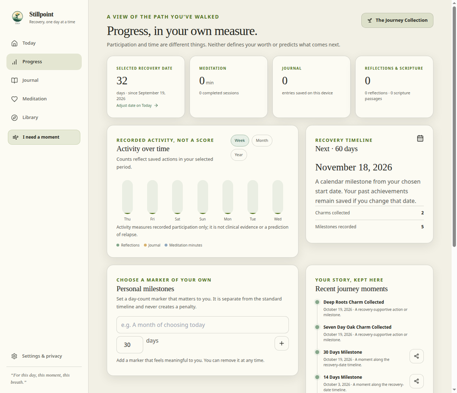
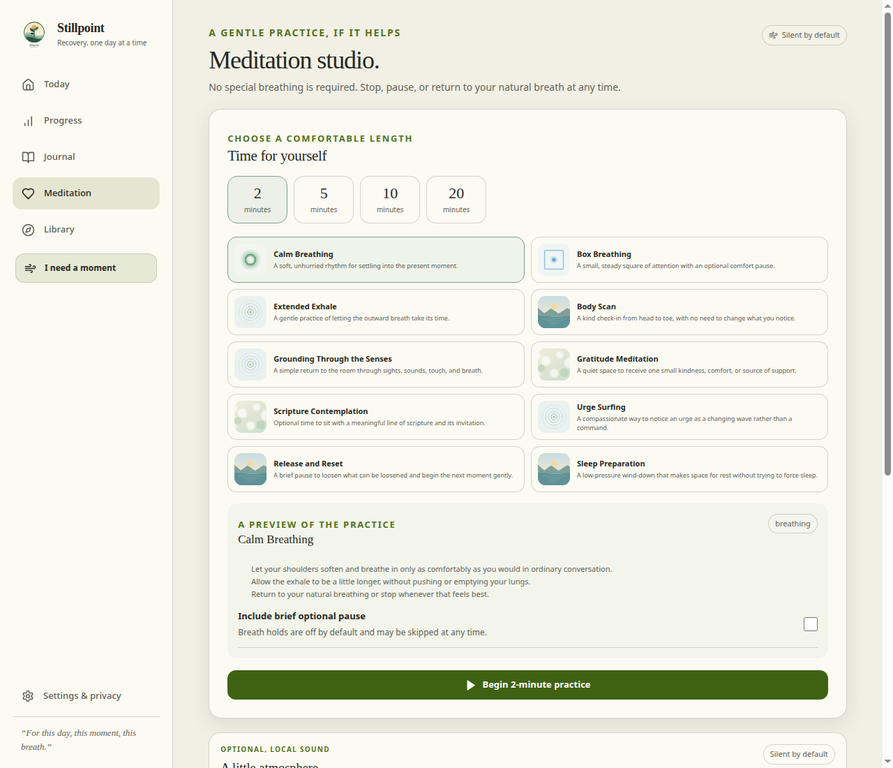
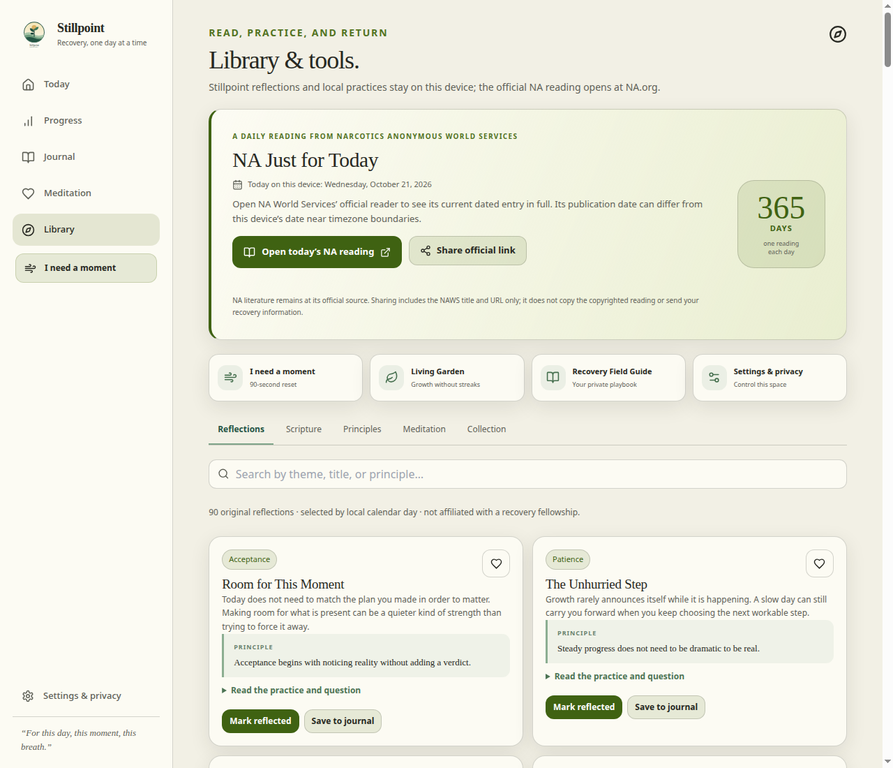
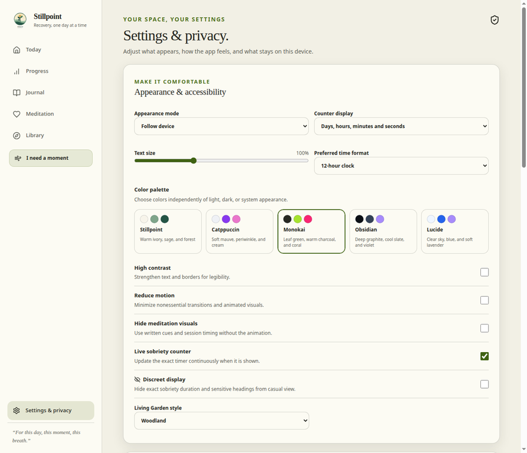

<div align="center">
  
  <h1>Stillpoint Recovery</h1>
  <p><strong>A quieter place to keep choosing what matters.</strong></p>
  <p>One day at a time. On your device. At your pace.</p>
  <p>
    <code>LOCAL-FIRST</code> &nbsp; <code>INSTALLABLE PWA</code> &nbsp; <code>NO ACCOUNT</code> &nbsp; <code>MIT LICENSE · SOURCE</code> &nbsp; <code>BUILT FOR GENTLENESS</code>
  </p>
  <p>
    <a href="https://github.com/mcochranca-code/stillpoint-recovery/archive/refs/heads/main.zip"><strong>Download the source ZIP</strong></a>
    &nbsp; · &nbsp;
    <a href="https://stillpoint-wulrzf.manus.space"><strong>Open the live app</strong></a>
    &nbsp; · &nbsp;
    <a href="#take-a-look-around">See the screenshots</a>
    &nbsp; · &nbsp;
    <a href="#run-it-on-your-device">Run it on your device</a>
  </p>
</div>

<p align="center">
  
</p>

<p align="center"><sub>The screen artwork uses illustrative sample values. Your own recovery information is not included in these images.</sub></p>

<details>
<summary><strong>Play the optional motion previews</strong> — slow, soft, and non-flashing</summary>

<p></p>
<p align="center"><sub>Dashboard motion: a quiet floating card, a softly moving progress ring, and a warm horizon.</sub></p>

<p></p>
<p align="center"><sub>Meditation motion is optional. Silence and natural breathing are always welcome.</sub></p>

<p><a href="docs/media/hero-still.png">View the still hero instead</a>. The motion files are small, locally included, and created from source-controlled HTML and CSS—no hosted animation service.</p>
</details>

---

## A recovery companion without the pressure

Recovery is personal. Stillpoint is designed to make room for reflection and supportive routines without turning your life into a score. There is no leaderboard, guilt loop, forced streak, or requirement to share your story.

### Take a look around

<table>
  <tr>
    <td width="50%" valign="top">
      <a href="docs/media/today.webp"></a>
      <h3>Today — one moment at a time</h3>
      <p>A visual, live day counter sits alongside an original daily reflection, optional scripture, and the official NA Just for Today reader link. Adjust or hide the counter whenever you want.</p>
    </td>
    <td width="50%" valign="top">
      <a href="docs/media/progress.webp"></a>
      <h3>Progress — your own measure</h3>
      <p>See calendar milestones, recorded activities, meditation time, journal entries, and personal goals. Activity is presented as context, not a prediction or a judgment.</p>
    </td>
  </tr>
  <tr>
    <td width="50%" valign="top">
      <a href="docs/media/meditation.webp"></a>
      <h3>Meditation — gentle by design</h3>
      <p>Choose a 2, 5, 10, or 20 minute practice. Optional local soundscapes stay silent until you choose them, and every session works without audio.</p>
    </td>
    <td width="50%" valign="top">
      <a href="docs/media/library.webp"></a>
      <h3>Library — return to what helps</h3>
      <p>Browse original reflections, public-domain scripture, recovery principles, meditation practices, and the Journey Collection of supportive milestones.</p>
    </td>
  </tr>
</table>

<p align="center"><sub>Product screenshots use a local demo profile with sample activity. No private journal content or personal contacts are shown.</sub></p>

<h3 align="center">Make the space your own</h3>
<p align="center"><a href="docs/media/settings.webp"></a></p>
<p align="center"><sub>Stillpoint, Catppuccin, Monokai, Obsidian, and Lucide—plus text size, contrast, reduced motion, and discreet display.</sub></p>

## Small practices. Useful details.

- **90 original daily reflections** offer a principle, a small practice, and a question to carry. They are written for Stillpoint and are not presented as fellowship literature.
- **NA Just for Today** opens the daily reading on the official [Narcotics Anonymous World Services site](https://na.org/daily-meditations/). Stillpoint does not copy, cache, or redistribute the copyrighted reading.
- **Our Daily Bread resources** link to the publisher’s official [Reading Plans](https://odb.org/page/reading-plans) and [podcast catalogue](https://odb.org/podcasts/) for Discover the Word. Stillpoint adds an original companion prompt, not publisher text.
- **Private journaling** supports gratitude, emotions, triggers, coping strategies, prayers, milestones, and free writing—with editable entries, search, and recoverable drafts.
- **Meditation Studio** includes ten gentle practices, selectable session lengths, pause and resume controls, and three bundled soundscapes: rain, woodland, and shoreline.
- **Five palettes**—Stillpoint, Catppuccin, Monokai, Obsidian, and Lucide—can be paired with text scaling, high contrast, reduced motion, and a discreet display.
- **Backups stay yours.** Export a versioned JSON backup or restore one on-device. Sharing is opt-in: the NA card shares the official link only, while milestone details are previewed and selected by you. You can also share or download a Stillpoint-branded standalone HTML milestone card; its name and date stay off unless selected.
- **Keep the parts that matter.** Journals, meditation history, and earned charms are not erased when you edit your recovery date.

## Motion is part of the design—not decoration

The app uses small CSS transitions for feedback and a slow, expanding meditation orb for optional practice. The README motion previews are source-controlled HTML/CSS compositions and open only when you choose them. Their motion draws from the same gentle visual language as the product: quiet floating, a soft pulse, and a gradual ring—never flashing or strobing.

Stillpoint also honors reduced-motion preferences. The meditation artwork uses an eight-second ease-in/ease-out cycle, and the interface disables nonessential animation when reduced motion is requested:

```css
@keyframes stillpoint-breathe {
  0%, 100% { transform: scale(.88); opacity: .82; }
  50% { transform: scale(1.06); opacity: 1; }
}

@media (prefers-reduced-motion: no-preference) {
  .breathing-orb {
    animation: stillpoint-breathe 8s ease-in-out infinite;
    transform-origin: center;
  }
}

@media (prefers-reduced-motion: reduce) {
  *, *::before, *::after {
    scroll-behavior: auto !important;
    animation-duration: .01ms !important;
    animation-iteration-count: 1 !important;
    transition-duration: .01ms !important;
  }
}
```

The compact [hero HTML/CSS](.github/readme-media/source/hero.html), [meditation vignette](.github/readme-media/source/breathing.html), [app motion stylesheet](public/assets/meditation/meditation-motion.css), and [render script](.github/readme-media/render.sh) are available in the repository. The motion examples were informed by [Prismic’s CSS animation examples](https://prismic.io/blog/css-animation-examples); they are adapted to Stillpoint’s palette, product, and reduced-motion behavior.

## Run it on your device

Stillpoint is a web app, not an App Store or Play Store download. You can download the repository as a ZIP using the button at the top, or clone it and run it locally. Once the local app opens in your browser, use the browser’s **Install app** or **Add to Home Screen** option if available.

Requirements: Node.js and the pnpm version pinned in `package.json`.

```sh
git clone https://github.com/mcochranca-code/stillpoint-recovery.git
cd stillpoint-recovery
pnpm install --frozen-lockfile
pnpm dev
```

Open `http://localhost:3000`. The app can be used without entering a recovery date; optional setup can be skipped. For a production build and local preview:

```sh
pnpm typecheck
pnpm lint
pnpm test
pnpm build
pnpm preview
```

The production build creates `dist/`, a web app manifest, a service worker, and a precache manifest for local app assets. Offline availability depends on the app shell and assets being successfully cached by your browser.

## Your information stays in your browser

Stillpoint stores recovery dates, preferences, journals, reflections, scripture activity, meditation sessions, earned charms, and related notes in this browser’s IndexedDB. The app does not require an account or cloud sync. It does not upload journal content to an app backend.

**Local does not mean encrypted.** Browser storage is not encrypted by Stillpoint. Clearing site data or uninstalling the PWA can erase saved information. Export a backup regularly and keep it somewhere private. Imported backups are validated and merged with duplicate IDs skipped.

Date-only recovery dates are interpreted as local midnight. If you add a start time, the chosen local time is converted to a saved timestamp. Editing the date preserves past journal entries, sessions, and earned charms.

Stillpoint is a personal reflection companion—not medical care, treatment, diagnosis, or an emergency service. Spiritual content and meditation are optional encouragement, never a measure of faith or worth and never a replacement for professional or peer support.

## Our Daily Bread resources

The Today card opens the publisher’s official Reading Plans and podcast catalogue for Discover the Word. Source links were checked on October 22, 2026. Stillpoint does not reproduce, cache, proxy, or automatically fetch ODB readings, plan descriptions, episode descriptions, transcripts, or artwork. The links open in a new tab with no referrer; Stillpoint does not attach a recovery profile, sobriety date, or journal text. A normal visit may still expose connection details to the publisher, whose privacy, cookie, analytics, and terms practices apply.

## Respect for NA literature

The Just for Today card links to the official [NA World Services daily-meditations page](https://na.org/daily-meditations/). NAWS controls the reading and its publication date, which may differ from the device’s local date near timezone boundaries. Stillpoint does not rehost the text. See NAWS’ [Intellectual Property Bulletin #1](https://na.org/wp-content/uploads/2024/06/IPBUL1-Oct2023.pdf) and [FIPT FAQ](https://na.org/service-material/fipt/fipt-faq/).

## License

The original application source code is available under the [MIT License](LICENSE). Its scope does not grant rights to bundled or user-supplied media, brand assets, third-party marks, Our Daily Bread or NAWS content, or dependency packages governed by their own licenses. Check the relevant rights before redistributing those materials.

## Built with

React · TypeScript · Vite · Tailwind CSS · Framer Motion · Dexie/IndexedDB · Vitest

<details>
<summary><strong>Project map</strong></summary>

- `src/app/` — application shell, routes, onboarding, and dialog focus management.
- `src/features/` — Today, Progress, Journal, Meditation, Library, Settings, Reset, Garden, and Field Guide.
- `src/components/` — reusable interface components and dialogs.
- `src/db/` — IndexedDB schema, migrations, repositories, milestones, and JSON backups.
- `src/domain/` — typed data, date math, sharing, achievement criteria, and domain calculations.
- `src/data/` — local reflections, scripture, exercises, charms, and palettes.
- `public/` — supplied brand assets, local soundscapes, PWA manifest, and service worker.
- `docs/media/` — still and motion visuals used by this README.
- `.github/readme-media/` — editable HTML/CSS motion sources and their renderer.

</details>

<p align="center"><sub>Made for the day you are in. Not affiliated with Narcotics Anonymous World Services.</sub></p>
