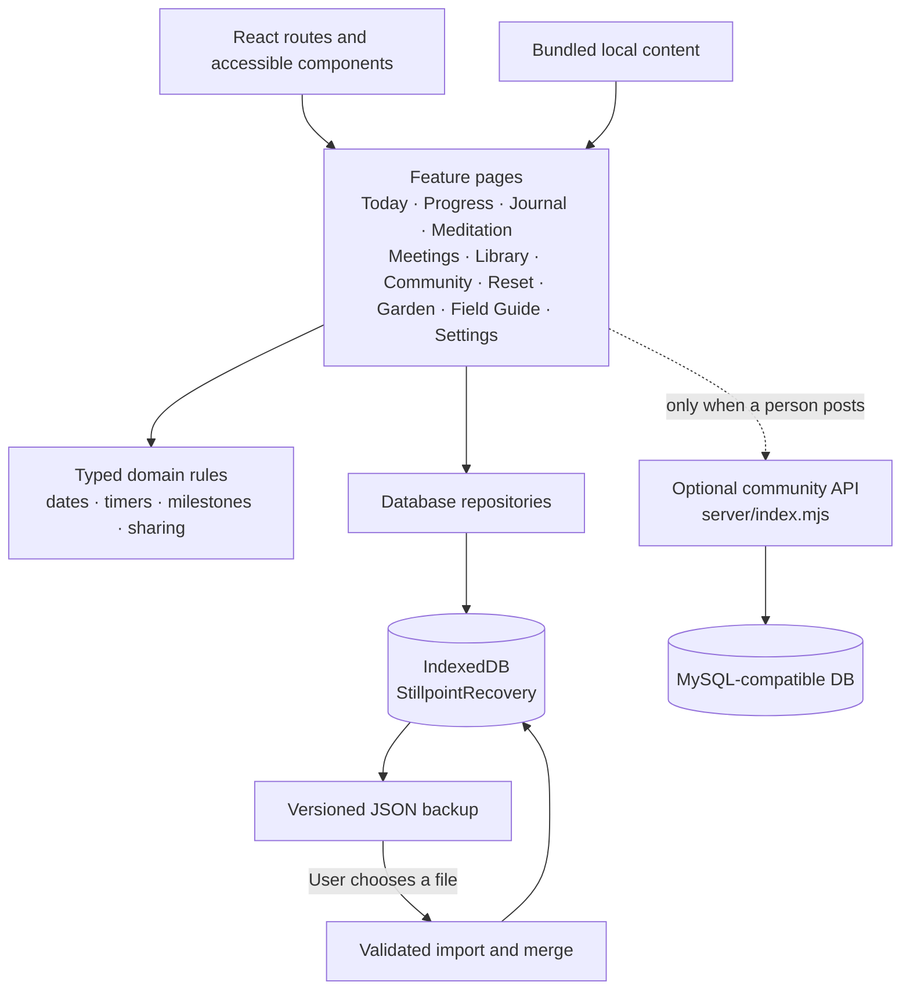

<div align="center">
  
  <h1>Stillpoint Recovery</h1>
  <p><strong>A quieter place to meet this day.</strong></p>
  <p>A private, local-first companion for recovery: pause, reflect, notice your progress, and choose one kind next step. No account, required recovery date, or streak pressure.</p>
  <p>
    <a href="https://stillpoint-mcvk9f6m.manus.space/"><strong>▶ Open the Manus app</strong></a>
    &nbsp; · &nbsp;
    <a href="https://stillpoint-recovery.vercel.app/"><strong>Vercel deployment</strong></a>
    &nbsp; · &nbsp;
    <a href="#screenshots">Screenshots</a>
    &nbsp; · &nbsp;
    <a href="#quick-start">Run it locally</a>
  </p>
</div>

<p align="center">
  <a href="https://github.com/mcochranca-code/stillpoint-recovery/actions/workflows/ci.yml"></a>
  <a href="https://github.com/mcochranca-code/stillpoint-recovery/actions/workflows/coverage.yml"></a>
  <a href="https://github.com/mcochranca-code/stillpoint-recovery/actions/workflows/accessibility.yml"></a>
  <a href="https://stillpoint-recovery.vercel.app/"></a>
  <a href="LICENSE"></a>
  <a href="docs/wiki/Home.md"></a>
</p>

<p align="center">
  
</p>
<p align="center"><sub>Screens use illustrative sample values. No personal recovery information is shown.</sub></p>

---

## Recovery, without the scorecard

Recovery is personal, and it rarely moves in a straight line. Stillpoint is designed to feel less like a scoreboard and more like a steady place to return: a daily reflection, a quiet practice, a private journal, a meeting finder, and a record of the progress that matters to you. Start without an account or even a recovery date. There are no leaderboards, guilt loops, or penalties for missed days.

- **Your story stays yours.** Journals, recovery dates, preferences, and activity are stored locally in your browser. Stillpoint does not require an account, run ads, or send private journal content to an AI service.
- **Ready for offline moments.** Install the PWA and use its app shell and bundled recovery content without a connection. Maps and explicitly enabled community notes are optional online features.
- **A pace that respects you.** Gentle visual design, reduced-motion settings, text scaling, high contrast, and a discreet display help make the app easier to use in your own way.
- **Faith content is optional.** Choose the Faith-neutral preset to hide Scripture-specific and Christian-extra sections without deleting saved data or removing other recovery tools.

## Small practices, thoughtfully brought together

- **A steady Today page** — an adjustable, hideable recovery counter, one of 90 original daily reflections, optional scripture, the official NA *Just for Today* link, and quick ways into meditation, meetings, or your journal.
- **Reflections worth returning to** — love a reading with the heart control and find your saved favorites in a dedicated Library tab. Reflections are original to Stillpoint, selected by local calendar day, and never presented as fellowship literature.
- **A private place to write** — capture gratitude, emotions, triggers, coping strategies, prayers, milestones, or free writing. Search and edit entries, recover drafts, and keep writing on this device.
- **Meditation at your pace** — ten gentle practices in 2, 5, 10, or 20 minutes, with pause/resume and bundled rain, woodland, and shoreline soundscapes. Box Breathing uses a calm breathing-orb visual in phase with its cues; ambient volume is adjustable.
- **Tools for difficult moments** — a short 90-second grounding flow, a Living Garden that never withers when you miss a day, and a Recovery Field Guide built from the support strategies you choose.
- **Progress without pressure** — explore activity and personal milestones, plus interactive virtual AA-style medallion and NA-style keytag designs for your latest reached recovery milestone. These are illustrative, not official fellowship-issued tokens; changing a recovery date does not erase your journals, sessions, or earned charms.
- **Local meeting references** — browse an offline, source-linked sample of AA/NA meetings in Stanislaus, Fresno, Mariposa, and Merced counties, alongside one Fresno Food Addicts (FA) listing. Coverage is partial; check [meeting sources](docs/meeting-sources.md) and confirm details with official directories.
- **A space that feels like yours** — choose from 15 palettes (Stillpoint, Catppuccin, Monokai, Obsidian, Lucide, Ocean Calm, Lavender Haze, Terra Cotta, Meadow, Morning Dawn, Midnight Blue, Rosewater, Alpine Air, Golden Hour, and Slate), accessibility controls, and matching browser/install icons.
- **Easy wayfinding** — keep a circular Home button within reach; the mobile header gets out of the way as you scroll and returns when you scroll up. Open the side menu from the left; Settings and accessibility stay at the top-right.
- **Backups you control** — export and restore versioned JSON backups on-device, and preview any milestone share before choosing to share it.
- **Community, only if you opt in** — account-free Community Notes are off by default, live on a separate board, load only after you open it, and require a separate choice before posting. See [Data and privacy](#data-and-privacy).

## Screenshots

<table>
  <tr>
    <td width="50%" valign="top">
      <a href="docs/media/today.webp"></a>
      <p><strong>Today</strong> — one moment at a time.</p>
    </td>
    <td width="50%" valign="top">
      <a href="docs/media/progress.webp"></a>
      <p><strong>Progress</strong> — your own measure, not a judgment.</p>
    </td>
  </tr>
  <tr>
    <td width="50%" valign="top">
      <a href="docs/media/meditation.webp"></a>
      <p><strong>Meditation</strong> — gentle by design.</p>
    </td>
    <td width="50%" valign="top">
      <a href="docs/media/library.webp"></a>
      <p><strong>Library</strong> — return to what helps.</p>
    </td>
  </tr>
</table>

  <p align="center"><a href="docs/media/settings.webp"></a></p>

<details>
<summary><strong>Optional motion previews</strong> (slow, soft, non-flashing)</summary>
<p></p>
<p></p>
<p>Both are rendered from source-controlled HTML and CSS in <a href=".github/readme-media/">.github/readme-media/</a>.</p>
</details>

## Who it's for

- **People in recovery** who want a quiet daily companion that keeps their reflections private and works without signing up.
- **People of faith**, especially Christians, who want optional scripture and devotional links alongside recovery practice.
- **Members of 12-step and peer fellowships** looking for a link to the daily NA reading and local AA/NA/FA meeting samples in California's Central Valley.
- **Peer supporters and contributors** who value privacy-respecting, accessible, open-source recovery tools.

Stillpoint is a personal reflection companion, **not** medical care, treatment, diagnosis, or an emergency service. Spiritual content and meditation are optional encouragement, never a replacement for professional or peer support.

---

## Tech stack

| Layer | Tools |
| --- | --- |
| UI | React 18, TypeScript, React Router, Tailwind CSS, Framer Motion, Lucide icons |
| Local data | Dexie on IndexedDB (database `StillpointRecovery`) |
| Maps | Leaflet with OpenStreetMap tiles (opt-in) |
| Build | Vite 6, custom precache manifest and service worker |
| Optional API | Node.js + Express 5, MySQL-compatible database via `mysql2` |
| Quality | Vitest, Testing Library, fake-indexeddb, axe-core, ESLint, Lighthouse CI, CodeQL |
| Tooling | Node.js 22, pnpm 11.25.0 |

## Architecture

The core app is a client-side React PWA. Features read and write through typed repositories backed by Dexie/IndexedDB, so **the browser is the system of record**. Static content (reflections, exercises, scripture references, themes, charms, and the dated meeting snapshot) is bundled with the app.



The one networked exception is the optional `/community` route, served by a small Express API in [`server/`](server/) under `/api/community` (plus `/healthz` for the standalone server). On Vercel it runs as a same-origin Vercel Function (Netlify Function config is kept as an alternative). It is off by default: the local `communityNotesEnabled` preference must be turned on in Settings before the route appears in navigation or the daily discussion mounts. It needs database settings (`DATABASE_URL`, or `DB_HOST`/`DB_PORT`/`DB_USER`/`DB_PASSWORD`/`DB_NAME`); without them, local runs keep working and the opt-in board reports that hosted notes are unavailable.

<details>
<summary><strong>Project map</strong></summary>

- `src/app/` — application shell, routes, onboarding, and dialog focus management.
- `src/features/` — Today, Progress, Journal, Meditation, Meetings, Community, Library, Settings, Reset, Garden, and Field Guide.
- `src/components/` — reusable interface components and dialogs.
- `src/db/` — IndexedDB schema, migrations, repositories, milestones, and JSON backups.
- `src/domain/` — typed data, date math, sharing, achievement criteria, and domain calculations.
- `src/data/` — reflections, scripture, exercises, charms, palettes, and the dated meeting and coordinate snapshots.
- `server/` — optional account-free community API, database migration, and moderation policy.
- `public/` — brand assets, soundscapes, PWA manifest, and service worker.
- `scripts/` — precache manifest, PWA artifact, coverage, and documentation-link checks.
- `docs/` — [wiki](docs/wiki/Home.md), [architecture decision records](docs/adr/README.md), media, meeting sources, and copyright records.

</details>

## Quick start

Requirements: **Node.js 22** and **pnpm 11.25.0** (pinned in `package.json`).

```sh
git clone https://github.com/mcochranca-code/stillpoint-recovery.git
cd stillpoint-recovery
pnpm install --frozen-lockfile
pnpm dev
```

Open `http://localhost:3000`. `pnpm dev` runs Vite on port 3000 and the community API on port 3001 (proxied at `/api`). Optional setup can be skipped, and no recovery date is required. To install the app, use your browser's **Install app** or **Add to Home Screen** option.

## Scripts

| Command | What it does |
| --- | --- |
| `pnpm dev` | Vite dev server (port 3000) plus the community API (port 3001) |
| `pnpm typecheck` | Strict TypeScript diagnostics |
| `pnpm lint` | ESLint |
| `pnpm test` | Vitest and Testing Library suite |
| `pnpm test:coverage` | Tests plus V8 coverage reports in `coverage/` |
| `pnpm check:coverage` | Per-file thresholds for critical modules |
| `pnpm build` | Typecheck, production bundle, and precache manifest |
| `pnpm verify:pwa` | Manifest, routes, service worker, and precache checks |
| `pnpm preview` | Serve the production build on port 3000 |
| `pnpm start` | Run the community API (`server/index.mjs`) |
| `pnpm check:server` | Syntax-check the server modules and the Vercel and Netlify Functions |
| `pnpm db:migrate` | Apply the community schema migration to the configured database |
| `node scripts/check-documentation-links.mjs` | Validate doc links, PDF anchors, and rights references |

## Testing and coverage

Tests cover domain rules (dates, timers, milestones), onboarding, journal create/edit/delete and draft recovery, meditation session state, backup validation and transactional restore, IndexedDB migrations and persistence, keyboard focus, meeting filters, Box Breathing phase positions, and the community API's router, policy, database settings, and Vercel/Netlify Function adapters (routing and the 503 unavailable state).

`pnpm test:coverage` enforces repository-wide minimums set in [`vite.config.ts`](vite.config.ts):

| Statements | Branches | Functions | Lines |
| --- | --- | --- | --- |
| 80% | 70% | 55% | 80% |

`pnpm check:coverage` then applies stricter per-file thresholds to critical modules such as `src/db/backup.ts`, `src/db/repository.ts`, and `src/domain/journal.ts` (see [`scripts/check-coverage-summary.mjs`](scripts/check-coverage-summary.mjs)).

### Continuous integration

| Workflow | Runs |
| --- | --- |
| [CI](.github/workflows/ci.yml) | Typecheck, lint, test, build, and PWA verification |
| [Test coverage](.github/workflows/coverage.yml) | Coverage thresholds and critical-module checks; also weekly |
| [Accessibility](.github/workflows/accessibility.yml) | Lighthouse accessibility check of the production build |
| [Documentation links](.github/workflows/documentation-links.yml) | Link, PDF-anchor, and notice checks; also weekly |
| [Workflow failure notifications](.github/workflows/notify-failures.yml) | Opens or resolves an issue when a workflow fails |
| [Release npm package](.github/workflows/release-npm.yml) | Validates and publishes on a `v*.*.*` tag matching `package.json` |

CodeQL analysis and Dependabot also run on the repository.

## Deployment

- **Vercel (PWA + community API, primary).** [`vercel.json`](vercel.json) builds the Vite app into `dist/`, adds an SPA fallback, and sets the same security headers as Netlify (CSP, `X-Frame-Options: DENY`, `nosniff`, referrer and permissions policies) plus no-cache rules for `index.html`, the manifest, `sw.js`, and `precache-manifest.json`; hashed `/assets/*` files are cached for a year. The community API runs on the same origin as a Vercel Function on the Node.js runtime ([`api/community.mjs`](api/community.mjs), which reuses `server/serverless.mjs`); `/api/community/*` is rewritten to it, so the app calls it same-origin and the CSP needs no extra hosts. Import the GitHub repo in Vercel (Hobby is enough) and production deploys follow pushes to `main`. Project settings (all also set in `vercel.json`):

  | Setting | Value |
  | --- | --- |
  | Framework Preset | Vite |
  | Install Command | `npx --yes pnpm@11.25.0 install --frozen-lockfile` |
  | Build Command | `npx --yes pnpm@11.25.0 run build` |
  | Output Directory | `dist` |
  | Node.js Version | 22.x (from `engines` in `package.json`) |
  | Root Directory | repository root |

- **Database settings (Vercel: Settings → Environment Variables, Production and Preview).** Either set the five separate variables, pasted raw with no URL-encoding:

  | Variable | Example (TiDB Cloud Starter) |
  | --- | --- |
  | `DB_HOST` | `gateway01.us-west-2.prod.aws.tidbcloud.com` |
  | `DB_PORT` | `4000` (defaults to `3306`) |
  | `DB_USER` | `<prefix>.root` |
  | `DB_PASSWORD` | the password exactly as shown (mark it Sensitive) |
  | `DB_NAME` | `stillpoint` |

  TLS is always required with these: TLSv1.2 minimum and certificate verification against the system CA store (which already trusts TiDB Cloud's ISRG Root X1 certificate). Or set a single `DATABASE_URL` as a `mysql://` URL whose `ssl` query parameter is URL-encoded JSON TLS settings:

  ```text
  mysql://<USER>.root:<PASSWORD>@gateway01.us-west-2.prod.aws.tidbcloud.com:4000/stillpoint?ssl=%7B%22minVersion%22%3A%22TLSv1.2%22%2C%22rejectUnauthorized%22%3Atrue%7D
  ```

  The `ssl` value decodes to `{"minVersion":"TLSv1.2","rejectUnauthorized":true}`; URL-encode any special characters in the password. If `DATABASE_URL` is set it wins over the `DB_*` variables. Never commit real values. Redeploy after changing them.
- **Netlify (fallback).** Production now runs on Vercel at <https://stillpoint-recovery.vercel.app/>; the Netlify setup is kept as a fallback. [`netlify.toml`](netlify.toml) and [`netlify/functions/community.mjs`](netlify/functions/community.mjs) are kept and work the same way (build `pnpm install --frozen-lockfile && pnpm build`, publish `dist/`, `/api/community/*` rewritten to the function). Set the same database variables under **Site configuration → Environment variables** (scope: Functions).
- **Migrations.** Migration `001_optional_reading_community` runs automatically on the first community request after each function cold start. It is idempotent (`CREATE TABLE IF NOT EXISTS` plus a `stillpoint_schema_migrations` record) and serialized with `GET_LOCK`, so concurrent instances are safe. To apply it ahead of time from a workstation, run `DATABASE_URL='mysql://…' pnpm db:migrate` (or set the `DB_*` variables instead). Notes older than 90 days are removed opportunistically, at most every six hours per warm function instance, and are never returned after 90 days regardless.
- **Without a database.** If no database settings are present, or they are incomplete or invalid, `/api/community/*` answers `503` JSON and the Community tab shows its unavailable message; the rest of the app is unaffected.
- **Docker (standalone community API).** The [`Dockerfile`](Dockerfile) builds on `node:22-alpine` and runs `server/index.mjs` on port 3000. There, the same database settings are required when `NODE_ENV=production`; on start the server applies the migration and removes expired notes daily.

The Just for Today card links to the official [NA World Services daily-meditations page](https://na.org/daily-meditations/). NAWS controls the reading and its publication date, which may differ from the device’s local date near timezone boundaries. The app does not rehost or embed the text. With redistribution authorization provided to the repository maintainer, an unchanged archival copy of *Just for Today: Daily Meditations for Recovering Addicts* is available in [`docs/copyright/Just-for-Today-NA.pdf`](docs/copyright/Just-for-Today-NA.pdf). The [daily reflection index](docs/copyright/Just-for-Today-index.md) lists dates, titles, and PDF page links only; it does not reproduce the meditation passages. Full attribution, permission scope, checksum, and non-affiliation language are recorded in [`docs/copyright/README.md`](docs/copyright/README.md).

Library → **NA Step Working Guides** is an in-app reader for *The Narcotics Anonymous Step Working Guides*, shown by permission of NA World Services (see [`CONTENT_SOURCES.md`](CONTENT_SOURCES.md#na-step-working-guides-used-by-permission)). It has a table of contents, resume-where-you-left-off, a reader text size, and an optional private answer box for every question. Answers are stored only in this browser's IndexedDB, are included in the JSON backup and in delete-all, and are never sent anywhere. The reader is reached from Library only; it is not part of the Today card rotation or any nudge. Stillpoint is not affiliated with or endorsed by NA. See NAWS’ [Intellectual Property Bulletin #1](https://na.org/wp-content/uploads/2024/06/IPBUL1-Oct2023.pdf) and [FIPT FAQ](https://na.org/service-material/fipt/fipt-faq/).
The production build creates `dist/`, a web app manifest, a service worker, and a precache manifest. The manifest uses standalone display with shortcuts for **Today**, **I need a moment**, and **Living Garden**. See [PWA and offline](docs/wiki/PWA-and-Offline.md).

## Data and privacy

**Local-first.** Recovery dates, preferences, journals, reflections, scripture activity, meditation sessions, charms, and notes are stored in this browser's IndexedDB. There is no account, cloud sync, or analytics pipeline in the core app, and journal content is never uploaded.

**Excluded from the MIT License: the NA Step Working Guides text.** The guide content in [`src/data/na-step-guides/guide.json`](src/data/na-step-guides/guide.json) (and anything derived from it) is *The Narcotics Anonymous Step Working Guides*, Copyright © 1998, World Service Office, Inc. Reprinted by permission. All rights reserved. It is NA Fellowship-approved literature, used in Stillpoint by permission of NA World Services and **not** licensed to you under MIT. Do not copy, adapt, or redistribute it outside this app without your own permission from NAWS. Permission status and sources are recorded in [`CONTENT_SOURCES.md`](CONTENT_SOURCES.md#na-step-working-guides-used-by-permission).

## Built with
**Local is not encrypted or permanent.** Stillpoint does not encrypt browser storage or exported backups. Clearing site data, removing the browser profile, or uninstalling the PWA may erase saved information. Export a backup regularly and keep it somewhere private. Maintainers cannot recover lost records; only a valid backup can.

**Backups and restore.** Backups are versioned JSON files. Restore previews counts and merges records locally; the profile and preferences replace saved values, duplicate IDs are skipped, and nothing syncs automatically between devices.

**Community notes (opt-in).** Posting sends only a short note (120 characters or fewer) scoped to the day, plus random, non-identifying keys this browser creates for rate limits and deletion (the server stores only their hashes). Reading notes sends only the day's reading key. Neither sends your recovery profile, sobriety date, journal, meeting, location, or meditation data. Notes are public, retained for up to 90 days, and deletion keys stay in the posting browser.

Community Notes are disabled on new installs. Turning them on is a local preference stored in IndexedDB; turning them off removes the destination and daily discussion without deleting private recovery records. The mobile navigation keeps a pinned Settings control visible even when the hamburger menu is closed.

**External links and maps.** NA, Our Daily Bread, and meeting-directory links open only when you click them, in a new tab, with no recovery data attached. The meeting map loads OpenStreetMap tiles only after you open it; tile requests reveal the viewed area, not your filters, search text, recovery data, or device location.

**Feedback survey.** Optional feedback goes to a [Jotform survey](https://form.jotform.com/262961231783057), which is subject to Jotform's own privacy practices.

More detail: [Data and Privacy guide](docs/wiki/Data-and-Privacy.md) · [ADR 0001: local-first storage](docs/adr/0001-local-first-storage.md).

## Content and attribution

- **NA *Just for Today*** opens on the official [NA World Services page](https://na.org/daily-meditations/); the app does not copy, cache, or embed the reading. An unchanged archival copy, shared with redistribution authorization to the maintainer, is documented in [`docs/copyright/README.md`](docs/copyright/README.md), and the [daily reflection index](docs/copyright/Just-for-Today-index.md) lists dates, titles, and page links only.
- **Our Daily Bread** links (Reading Plans and the Discover the Word podcast) appear only after choosing Christian under **Settings → Daily readings** and turning on **Show Christian extras**. Stillpoint adds an original prompt and does not reproduce publisher text.
- **Meetings** data is a dated, partial snapshot with sources listed in [`docs/meeting-sources.md`](docs/meeting-sources.md).

Not affiliated with Narcotics Anonymous World Services, Our Daily Bread Ministries, or any fellowship.

## Contributing

Contributions are welcome. Please read [Contributing and Troubleshooting](docs/wiki/Contributing-and-Troubleshooting.md) first. In short:

1. Branch from `main` and keep one concern per pull request.
2. Keep recovery data local by default: no hidden uploads, analytics, or required accounts.
3. Preserve keyboard access, focus, text scaling, high contrast, reduced motion, and discreet mode.
4. Use supportive, non-clinical language, and don't claim encryption, medical efficacy, or outcomes the code doesn't support.
5. Run `pnpm typecheck`, `pnpm lint`, `pnpm test`, `pnpm build`, and the documentation checker before opening a PR.

Deeper docs live in the [project wiki](docs/wiki/Home.md): getting started, architecture, PWA/offline, testing and CI, accessibility validation, and content and licensing.

## License

[MIT](LICENSE) © 2026 Stillpoint Recovery contributors. The license covers the original application source and documentation in this repository. It does not grant rights to bundled or user-supplied media, brand assets, third-party marks, Our Daily Bread or NAWS content, or dependency packages under their own licenses.

<p align="center"><sub>Made for the day you are in.</sub></p>
