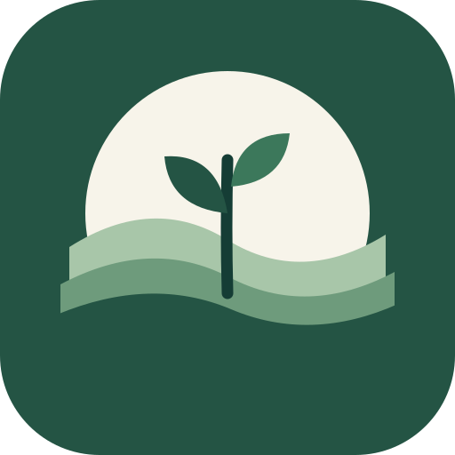
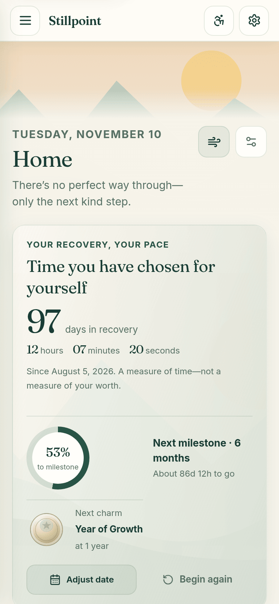
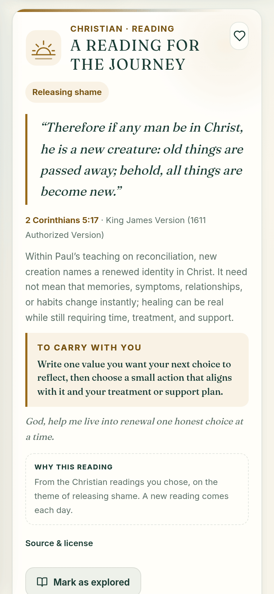
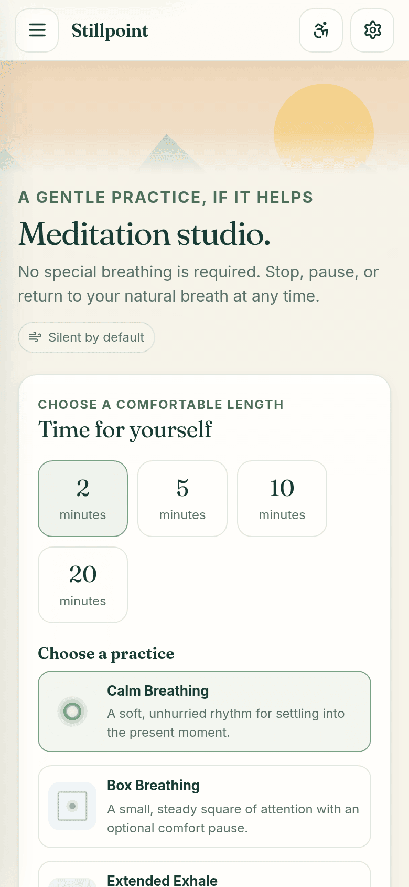
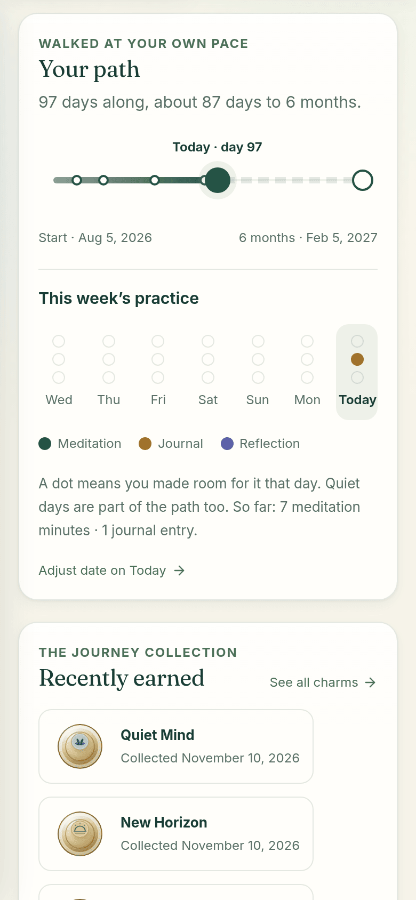
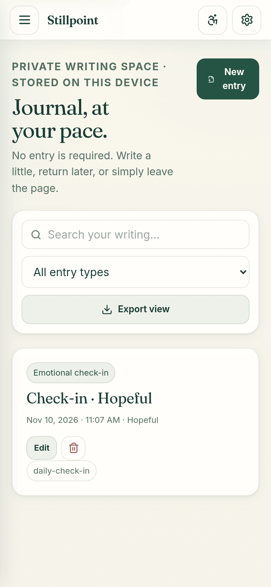
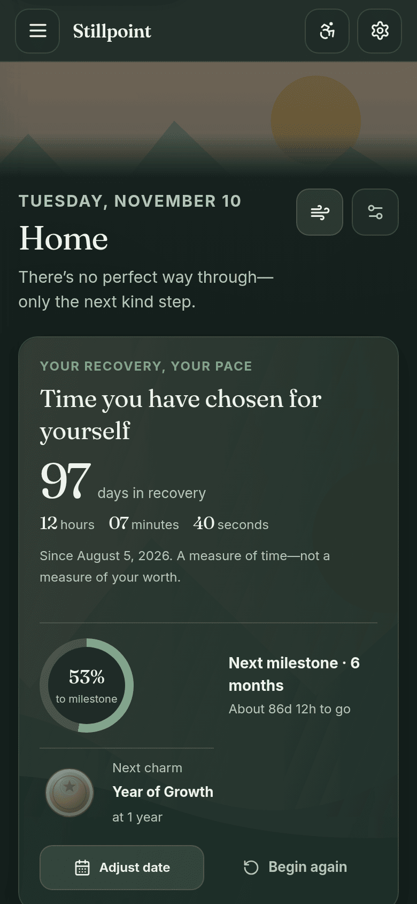
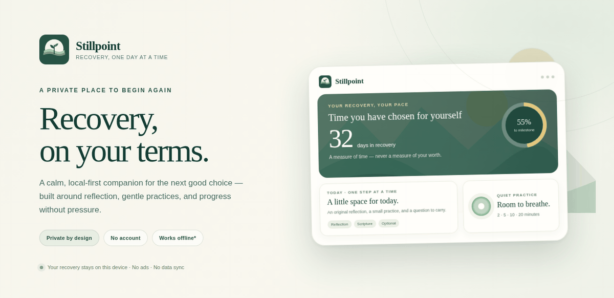
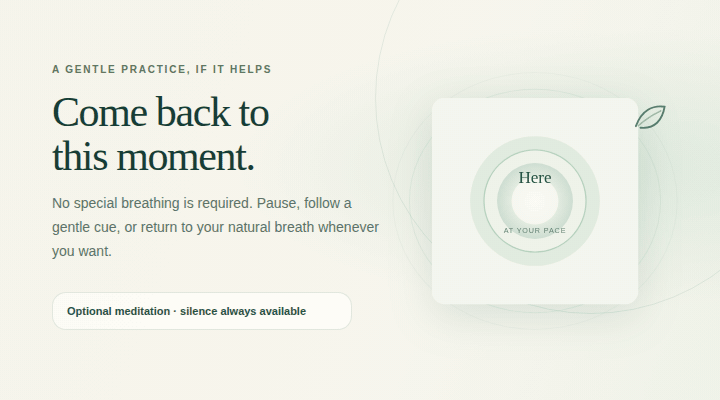
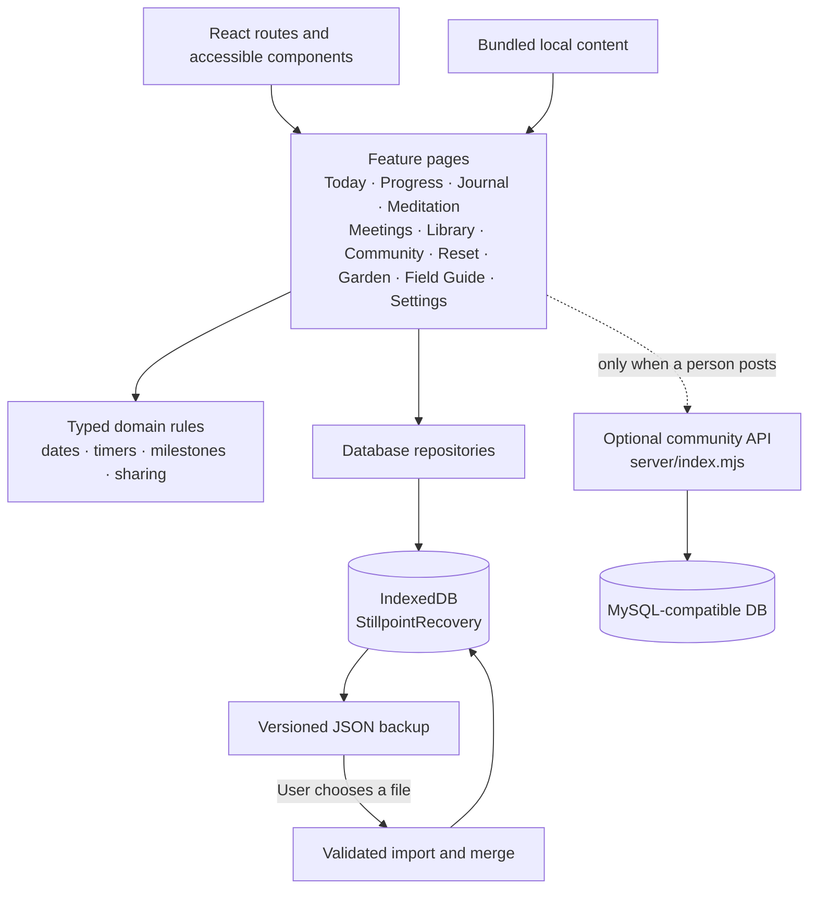

<div align="center">
  
  <h1>Stillpoint Recovery</h1>
  <p><strong>A private, faith-friendly recovery companion. No account. Your data stays on your phone.</strong></p>
  <p>Daily readings you choose, gentle meditation, a private journal, and local meeting samples, all kept in your own browser. No streak pressure. One day at a time.</p>
  <p>
    <a href="https://stillpoint-recovery.vercel.app/"><strong>▶ Open the live app</strong></a>
    &nbsp; · &nbsp;
    <a href="https://stillpoint-mcvk9f6m.manus.space/">Manus app</a>
    &nbsp; · &nbsp;
    <a href="#install-on-your-phone">Install on your phone</a>
    &nbsp; · &nbsp;
    <a href="#our-privacy-promise">Privacy promise</a>
    &nbsp; · &nbsp;
    <a href="docs/marketing/one-pager.md">One-pager for programs</a>
    &nbsp; · &nbsp;
    <a href="#quick-start">Run it locally</a>
  </p>
</div>

<p align="center">
  <a href="https://github.com/mcochranca-code/stillpoint-recovery/actions/workflows/ci.yml"></a>
  <a href="https://github.com/mcochranca-code/stillpoint-recovery/actions/workflows/coverage.yml"></a>
  <a href="https://github.com/mcochranca-code/stillpoint-recovery/actions/workflows/accessibility.yml"></a>
  <a href="https://stillpoint-recovery.vercel.app/"></a>
  <a href="LICENSE"></a>
  <a href="docs/wiki/Home.md"></a>
</p>

## Screenshots

<table>
  <tr>
    <td align="center" valign="top">
      
      <p><strong>Today</strong><br><sub>Time you have chosen for yourself.</sub></p>
    </td>
    <td align="center" valign="top">
      
      <p><strong>Your reading</strong><br><sub>From the traditions you choose.</sub></p>
    </td>
    <td align="center" valign="top">
      
      <p><strong>Meditation studio</strong><br><sub>Stop, pause, or return any time.</sub></p>
    </td>
  </tr>
  <tr>
    <td align="center" valign="top">
      
      <p><strong>Your path</strong><br><sub>Quiet days are part of the path too.</sub></p>
    </td>
    <td align="center" valign="top">
      
      <p><strong>Private journal</strong><br><sub>Stored on this device.</sub></p>
    </td>
    <td align="center" valign="top">
      
      <p><strong>Dark appearance</strong><br><sub>Easy on the eyes at night.</sub></p>
    </td>
  </tr>
</table>

<p align="center"><sub>Screens use illustrative sample values from a fresh test profile. No personal recovery information is shown. Captured with <code>pnpm screenshots</code>.</sub></p>

<p align="center"><sub>More screens: <a href="docs/media/library.webp">Library</a> · <a href="docs/media/settings.webp">Settings, palettes, and accessibility</a></sub></p>

<details>
<summary><strong>Optional motion previews</strong> (slow, soft, non-flashing)</summary>
<p></p>
<p></p>
<p>Both are rendered from source-controlled HTML and CSS in <a href=".github/readme-media/">.github/readme-media/</a>.</p>
</details>

---

## Why Stillpoint

Recovery is personal. A lot of apps turn it into a score. Stillpoint makes room for reflection and steady routines instead: no leaderboard, no guilt loop, no forced streak, and no need to share your story. The core app works without an account and without a recovery date.

- **Your data stays on your device.** Journals, dates, readings, meditation sessions, and charms are stored in your browser's IndexedDB. There is no account, no cloud sync, no ads, and no analytics. See [Our privacy promise](#our-privacy-promise) for exactly what can leave the device, and when.
- **Readings you choose, from seven traditions.** Christian, Buddhist, Hindu, Muslim, Jain, Red Road (Native wellbriety), and Spiritual but not religious. Pick one, a few that take turns, or rotate through all of them. Nothing is preselected for you, and a Faith-neutral preset hides Scripture-specific sections without deleting anything.
- **No streak pressure.** Missing a day never breaks anything. Progress is a gentle path from your start date to the next milestone, with a week of practice shown as simple dots. A quiet day is just a quiet day, and changing your date redraws the path without erasing journals, sessions, or earned charms.
- **Milestone charms.** Twelve illustrated charms, from First Light to Year of Growth. Today shows the next one ahead, Progress shows the ones you have earned, and the whole collection has its own page.
- **"I need a moment."** One tap from the menu (and an install shortcut) opens a 90-second pause: name what you feel if that helps, then breathe, ground yourself, write a few words, read a short prayer, or see the trusted people you saved. It is honest about what it is: a pause, not a promise, and not an emergency service.
- **Meditation studio.** Ten gentle practices in 2, 5, 10, or 20 minute sessions, with pause and resume and three bundled soundscapes. Silent by default.
- **Works offline, installs like an app.** It is a PWA: add it to your home screen and the app shell and bundled content are cached on your device. Maps and explicitly enabled community notes are optional online features.
- **Accessible by design.** Reduced motion, high contrast, an adjustable text size (85% to 130%), discreet mode, full keyboard access, and screen-reader support through labelled controls and text equivalents for every visual. Automated axe and contrast checks run in the test suite, and Lighthouse runs in CI.

## Key features

- **Today** — a live, adjustable (or hideable) day counter, an original daily reflection, optional scripture, and a link to the official NA *Just for Today* reading, plus quick shortcuts to a quiet practice, meetings, and the journal.
- **90 original daily reflections** — each with a principle, a small practice, and a question to carry. Written for Stillpoint; not presented as fellowship literature. Love a reflection with the heart control and find it again in the Library **Favorites** tab.
- **Private journal** — gratitude, emotions, triggers, coping strategies, prayers, milestones, and free writing, with editing, search, and recoverable drafts.
- **Meditation Studio** — ten gentle practices in 2, 5, 10, or 20 minute sessions, pause and resume, and three bundled soundscapes (rain, woodland, shoreline) with a working volume control. Box Breathing follows a highlighted sphere in phase with the cues.
- **90-second Reset, Living Garden, and Field Guide** — a brief grounding flow, non-punitive visual growth, and user-built coping notes.
- **Progress and Journey Collection** — a gentle path to the next milestone, a week of practice, activity, meditation time, personal goals, the charm collection, and a dedicated Tokens tab with interactive AA medallion/NA keytag virtual 3D designs for only the latest reached milestone. These are not official fellowship issuances; editing your recovery date never erases journals, sessions, or earned charms.
- **Meetings** — an offline, source-linked sample of public AA/NA schedules for Stanislaus, Fresno, Mariposa, and Merced counties, plus one Fresno Food Addicts (FA) listing, with on-device filters and an optional map. Coverage is partial; see [meeting sources](docs/meeting-sources.md) and confirm with official directories.
- **Make it yours** — fifteen palettes (Stillpoint, Catppuccin, Monokai, Obsidian, Lucide, Ocean Calm, Lavender Haze, Terra Cotta, Meadow, Morning Dawn, Midnight Blue, Rosewater, Alpine Air, Golden Hour, and Slate), accessibility controls, and a matching browser/app icon for the selected theme when saving or installing.
- **Wayfinding** — on mobile, a circular Home button stays within reach, the header gets out of the way as you scroll down and returns when you scroll up, the side menu opens from the left, and Settings and accessibility options stay at the top right. Mobile destinations can be shown/hidden or expanded/collapsed with motion-aware controls.
- **Backups you control** — export and restore versioned JSON backups on-device, and opt-in milestone sharing that you preview first.
- **Optional community notes** — off by default; enable them in Settings if you want a first-class, account-free navigation destination with a separate shared board. Notes are fetched only after you explicitly open the board, and posting is a separate choice (see [Our privacy promise](#our-privacy-promise)).

## Who it's for

- **People in recovery** who want a quiet daily companion that keeps their reflections private and works without signing up.
- **Peer support specialists** who want something simple to recommend that asks a person for nothing: no account, no email, no data handed over.
- **Counselors and clinicians** looking for a between-sessions tool for reflection and grounding that does not collect client data.
- **Members of 12-step and peer fellowships** looking for a link to the daily NA reading and local AA/NA/FA meeting samples in California's Central Valley.
- **Faith communities** of many traditions, including recovery ministries, who want readings that respect a person's own faith, or none.
- **Recovery programs** that want a free, open-source companion to offer participants, with partial Central Valley meeting samples built in.

Stillpoint is a personal reflection companion, **not** medical care, treatment, diagnosis, or an emergency service. Spiritual content and meditation are optional encouragement, never a replacement for professional or peer support.

## Install on your phone

Open **<https://stillpoint-recovery.vercel.app/>**, then:

- **iPhone or iPad (Safari):** tap **Share**, then **Add to Home Screen**.
- **Android (Chrome):** tap the **⋮** menu, then **Install app** (some versions say **Add to Home screen**).

The installed app opens on its own, works offline, and offers shortcuts for **Today**, **I need a moment**, and **Living Garden**. Your data stays in that browser on that device; nothing syncs between devices, so use **Settings → backup** to move or keep a copy.

## Our privacy promise

Stillpoint has no account, no cloud sync, no ads, and no analytics. Your recovery date, journal, readings, meditation sessions, charms, contacts, and settings are stored only in this browser on this device. Here is everything that can leave it, and when:

| What | When | What is sent | To whom |
| --- | --- | --- | --- |
| Loading the app | Opening or updating the app | Ordinary web requests for the app files. No recovery data. | The host (Vercel) |
| Community notes (**off by default**) | Only after you turn them on in Settings **and** open the board | Reading: the day's reading key. Posting: your note (120 characters or fewer), the reading key, and random keys this browser makes for rate limits and deletion (the server stores only their hashes). Reporting or deleting a note sends that note's ID and the matching key. | Stillpoint's community API |
| Meeting map | Only after you open the optional map | Map tile requests, which reveal the area you are viewing | OpenStreetMap |
| "Show my approximate position" | Only when you press that button on the map | Your browser asks your permission. The position stays in memory on that page, is never saved, and is never sent to Stillpoint. The tiles loaded for that area can reveal it approximately to OpenStreetMap. | OpenStreetMap (tiles only) |
| Outside links (NA, Our Daily Bread, meeting directories, feedback survey) | Only when you click them | A normal page visit in a new tab, with no recovery data attached | That site, under its own privacy practices |

Community notes are public and kept for up to 90 days. They never include your recovery profile, sobriety date, journal, meetings, location, or meditation data.

Two honest limits: browser storage and exported backups are **not encrypted**, and clearing site data or uninstalling can erase what you saved. Export a backup and keep it somewhere private. Full detail is in [Data and privacy](#data-and-privacy) below.

## For programs and contributors

- **Recovery programs, peer support teams, and faith communities:** Stillpoint is free, MIT-licensed, and needs no accounts, so there is nothing to procure and no participant data to manage. Read the [one-pager](docs/marketing/one-pager.md) for how to pilot it, then [open an issue](https://github.com/mcochranca-code/stillpoint-recovery/issues) to share what your participants need.
- **Contributors:** designers, writers, developers, accessibility testers, and people with lived experience are all welcome. Start with [Contributing](#contributing) and the [project wiki](docs/wiki/Home.md).


---

## Tech stack

| Layer | Tools |
| --- | --- |
| UI | React 18, TypeScript, React Router, Tailwind CSS, Framer Motion, Lucide icons |
| Local data | Dexie on IndexedDB (database `StillpointRecovery`) |
| Maps | Leaflet with OpenStreetMap tiles (opt-in) |
| Build | Vite 6, custom precache manifest and service worker |
| Optional API | Node.js + Express 5, MySQL-compatible database via `mysql2` |
| Quality | Vitest, Testing Library, fake-indexeddb, axe-core, ESLint, Lighthouse CI, CodeQL |
| Tooling | Node.js 22, pnpm 11.25.0 |

## Architecture

The core app is a client-side React PWA. Features read and write through typed repositories backed by Dexie/IndexedDB, so **the browser is the system of record**. Static content (reflections, exercises, scripture references, themes, charms, and the dated meeting snapshot) is bundled with the app.



The one networked exception is the optional `/community` route, served by a small Express API in [`server/`](server/) under `/api/community` (plus `/healthz` for the standalone server). On Vercel it runs as a same-origin Vercel Function (Netlify Function config is kept as an alternative). It is off by default: the local `communityNotesEnabled` preference must be turned on in Settings before the route appears in navigation or the daily discussion mounts. It needs database settings (`DATABASE_URL`, or `DB_HOST`/`DB_PORT`/`DB_USER`/`DB_PASSWORD`/`DB_NAME`); without them, local runs keep working and the opt-in board reports that hosted notes are unavailable.

<details>
<summary><strong>Project map</strong></summary>

- `src/app/` — application shell, routes, onboarding, and dialog focus management.
- `src/features/` — Today, Progress, Journal, Meditation, Meetings, Community, Library, Settings, Reset, Garden, and Field Guide.
- `src/components/` — reusable interface components and dialogs.
- `src/db/` — IndexedDB schema, migrations, repositories, milestones, and JSON backups.
- `src/domain/` — typed data, date math, sharing, achievement criteria, and domain calculations.
- `src/data/` — reflections, scripture, exercises, charms, palettes, and the dated meeting and coordinate snapshots.
- `server/` — optional account-free community API, database migration, and moderation policy.
- `public/` — brand assets, soundscapes, PWA manifest, and service worker.
- `scripts/` — precache manifest, PWA artifact, coverage, and documentation-link checks.
- `docs/` — [wiki](docs/wiki/Home.md), [architecture decision records](docs/adr/README.md), media, meeting sources, and copyright records.

</details>

## Quick start

Requirements: **Node.js 22** and **pnpm 11.25.0** (pinned in `package.json`).

```sh
git clone https://github.com/mcochranca-code/stillpoint-recovery.git
cd stillpoint-recovery
pnpm install --frozen-lockfile
pnpm dev
```

Open `http://localhost:3000`. `pnpm dev` runs Vite on port 3000 and the community API on port 3001 (proxied at `/api`). Optional setup can be skipped, and no recovery date is required. To install the app, use your browser's **Install app** or **Add to Home Screen** option.

## Scripts

| Command | What it does |
| --- | --- |
| `pnpm dev` | Vite dev server (port 3000) plus the community API (port 3001) |
| `pnpm typecheck` | Strict TypeScript diagnostics |
| `pnpm lint` | ESLint |
| `pnpm test` | Vitest and Testing Library suite |
| `pnpm test:coverage` | Tests plus V8 coverage reports in `coverage/` |
| `pnpm check:coverage` | Per-file thresholds for critical modules |
| `pnpm build` | Typecheck, production bundle, and precache manifest |
| `pnpm verify:pwa` | Manifest, routes, service worker, and precache checks |
| `pnpm preview` | Serve the production build on port 3000 |
| `pnpm start` | Run the community API (`server/index.mjs`) |
| `pnpm check:server` | Syntax-check the server modules and the Vercel and Netlify Functions |
| `pnpm db:migrate` | Apply the community schema migration to the configured database |
| `node scripts/check-documentation-links.mjs` | Validate doc links, PDF anchors, and rights references |

## Testing and coverage

Tests cover domain rules (dates, timers, milestones), onboarding, journal create/edit/delete and draft recovery, meditation session state, backup validation and transactional restore, IndexedDB migrations and persistence, keyboard focus, meeting filters, Box Breathing phase positions, and the community API's router, policy, database settings, and Vercel/Netlify Function adapters (routing and the 503 unavailable state).

`pnpm test:coverage` enforces repository-wide minimums set in [`vite.config.ts`](vite.config.ts):

| Statements | Branches | Functions | Lines |
| --- | --- | --- | --- |
| 80% | 70% | 55% | 80% |

`pnpm check:coverage` then applies stricter per-file thresholds to critical modules such as `src/db/backup.ts`, `src/db/repository.ts`, and `src/domain/journal.ts` (see [`scripts/check-coverage-summary.mjs`](scripts/check-coverage-summary.mjs)).

### Continuous integration

| Workflow | Runs |
| --- | --- |
| [CI](.github/workflows/ci.yml) | Typecheck, lint, test, build, and PWA verification |
| [Test coverage](.github/workflows/coverage.yml) | Coverage thresholds and critical-module checks; also weekly |
| [Accessibility](.github/workflows/accessibility.yml) | Lighthouse accessibility check of the production build |
| [Documentation links](.github/workflows/documentation-links.yml) | Link, PDF-anchor, and notice checks; also weekly |
| [Workflow failure notifications](.github/workflows/notify-failures.yml) | Opens or resolves an issue when a workflow fails |
| [Release npm package](.github/workflows/release-npm.yml) | Validates and publishes on a `v*.*.*` tag matching `package.json` |

CodeQL analysis and Dependabot also run on the repository.

## Deployment

- **Vercel (PWA + community API, primary).** [`vercel.json`](vercel.json) builds the Vite app into `dist/`, adds an SPA fallback, and sets the same security headers as Netlify (CSP, `X-Frame-Options: DENY`, `nosniff`, referrer and permissions policies) plus no-cache rules for `index.html`, the manifest, `sw.js`, and `precache-manifest.json`; hashed `/assets/*` files are cached for a year. The community API runs on the same origin as a Vercel Function on the Node.js runtime ([`api/community.mjs`](api/community.mjs), which reuses `server/serverless.mjs`); `/api/community/*` is rewritten to it, so the app calls it same-origin and the CSP needs no extra hosts. Import the GitHub repo in Vercel (Hobby is enough) and production deploys follow pushes to `main`. Project settings (all also set in `vercel.json`):

  | Setting | Value |
  | --- | --- |
  | Framework Preset | Vite |
  | Install Command | `npx --yes pnpm@11.25.0 install --frozen-lockfile` |
  | Build Command | `npx --yes pnpm@11.25.0 run build` |
  | Output Directory | `dist` |
  | Node.js Version | 22.x (from `engines` in `package.json`) |
  | Root Directory | repository root |

- **Database settings (Vercel: Settings → Environment Variables, Production and Preview).** Either set the five separate variables, pasted raw with no URL-encoding:

  | Variable | Example (TiDB Cloud Starter) |
  | --- | --- |
  | `DB_HOST` | `gateway01.us-west-2.prod.aws.tidbcloud.com` |
  | `DB_PORT` | `4000` (defaults to `3306`) |
  | `DB_USER` | `<prefix>.root` |
  | `DB_PASSWORD` | the password exactly as shown (mark it Sensitive) |
  | `DB_NAME` | `stillpoint` |

  TLS is always required with these: TLSv1.2 minimum and certificate verification against the system CA store (which already trusts TiDB Cloud's ISRG Root X1 certificate). Or set a single `DATABASE_URL` as a `mysql://` URL whose `ssl` query parameter is URL-encoded JSON TLS settings:

  ```text
  mysql://<USER>.root:<PASSWORD>@gateway01.us-west-2.prod.aws.tidbcloud.com:4000/stillpoint?ssl=%7B%22minVersion%22%3A%22TLSv1.2%22%2C%22rejectUnauthorized%22%3Atrue%7D
  ```

  The `ssl` value decodes to `{"minVersion":"TLSv1.2","rejectUnauthorized":true}`; URL-encode any special characters in the password. If `DATABASE_URL` is set it wins over the `DB_*` variables. Never commit real values. Redeploy after changing them.
- **Netlify (fallback).** Production now runs on Vercel at <https://stillpoint-recovery.vercel.app/>; the Netlify setup is kept as a fallback. [`netlify.toml`](netlify.toml) and [`netlify/functions/community.mjs`](netlify/functions/community.mjs) are kept and work the same way (build `pnpm install --frozen-lockfile && pnpm build`, publish `dist/`, `/api/community/*` rewritten to the function). Set the same database variables under **Site configuration → Environment variables** (scope: Functions).
- **Migrations.** Migration `001_optional_reading_community` runs automatically on the first community request after each function cold start. It is idempotent (`CREATE TABLE IF NOT EXISTS` plus a `stillpoint_schema_migrations` record) and serialized with `GET_LOCK`, so concurrent instances are safe. To apply it ahead of time from a workstation, run `DATABASE_URL='mysql://…' pnpm db:migrate` (or set the `DB_*` variables instead). Notes older than 90 days are removed opportunistically, at most every six hours per warm function instance, and are never returned after 90 days regardless.
- **Without a database.** If no database settings are present, or they are incomplete or invalid, `/api/community/*` answers `503` JSON and the Community tab shows its unavailable message; the rest of the app is unaffected.
- **Docker (standalone community API).** The [`Dockerfile`](Dockerfile) builds on `node:22-alpine` and runs `server/index.mjs` on port 3000. There, the same database settings are required when `NODE_ENV=production`; on start the server applies the migration and removes expired notes daily.

The Just for Today card links to the official [NA World Services daily-meditations page](https://na.org/daily-meditations/). NAWS controls the reading and its publication date, which may differ from the device’s local date near timezone boundaries. The app does not rehost or embed the text. With redistribution authorization provided to the repository maintainer, an unchanged archival copy of *Just for Today: Daily Meditations for Recovering Addicts* is available in [`docs/copyright/Just-for-Today-NA.pdf`](docs/copyright/Just-for-Today-NA.pdf). The [daily reflection index](docs/copyright/Just-for-Today-index.md) lists dates, titles, and PDF page links only; it does not reproduce the meditation passages. Full attribution, permission scope, checksum, and non-affiliation language are recorded in [`docs/copyright/README.md`](docs/copyright/README.md).

Library → **NA Step Working Guides** is an in-app reader for *The Narcotics Anonymous Step Working Guides*, shown by permission of NA World Services (see [`CONTENT_SOURCES.md`](CONTENT_SOURCES.md#na-step-working-guides-used-by-permission)). It has a table of contents, resume-where-you-left-off, a reader text size, and an optional private answer box for every question. Answers are stored only in this browser's IndexedDB, are included in the JSON backup and in delete-all, and are never sent anywhere. The reader is reached from Library only; it is not part of the Today card rotation or any nudge. Stillpoint is not affiliated with or endorsed by NA. See NAWS’ [Intellectual Property Bulletin #1](https://na.org/wp-content/uploads/2024/06/IPBUL1-Oct2023.pdf) and [FIPT FAQ](https://na.org/service-material/fipt/fipt-faq/).
The production build creates `dist/`, a web app manifest, a service worker, and a precache manifest. The manifest uses standalone display with shortcuts for **Today**, **I need a moment**, and **Living Garden**. See [PWA and offline](docs/wiki/PWA-and-Offline.md).

## Data and privacy

**Local-first.** Recovery dates, preferences, journals, reflections, scripture activity, meditation sessions, charms, and notes are stored in this browser's IndexedDB. There is no account, cloud sync, or analytics pipeline in the core app, and journal content is never uploaded.

**Local is not encrypted or permanent.** Stillpoint does not encrypt browser storage or exported backups. Clearing site data, removing the browser profile, or uninstalling the PWA may erase saved information. Export a backup regularly and keep it somewhere private. Maintainers cannot recover lost records; only a valid backup can.

**Backups and restore.** Backups are versioned JSON files. Restore previews counts and merges records locally; the profile and preferences replace saved values, duplicate IDs are skipped, and nothing syncs automatically between devices.

**Community notes (opt-in).** Posting sends only a short note (120 characters or fewer) scoped to the day, plus random, non-identifying keys this browser creates for rate limits and deletion (the server stores only their hashes). Reading notes sends only the day's reading key. Neither sends your recovery profile, sobriety date, journal, meeting, location, or meditation data. Notes are public, retained for up to 90 days, and deletion keys stay in the posting browser.

Community Notes are disabled on new installs. Turning them on is a local preference stored in IndexedDB; turning them off removes the destination and daily discussion without deleting private recovery records. The mobile navigation keeps a pinned Settings control visible even when the hamburger menu is closed.

**External links and maps.** NA, Our Daily Bread, and meeting-directory links open only when you click them, in a new tab, with no recovery data attached. The meeting map loads OpenStreetMap tiles only after you open it; tile requests reveal the viewed area, not your filters, search text, recovery data, or device location. The map's optional **Show my approximate position** button asks the browser for your location only when you press it; the position stays in memory on that page, is never saved or sent to Stillpoint, and is cleared when the map closes, though tiles loaded for that area can reveal it approximately to OpenStreetMap.

**Feedback survey.** Optional feedback goes to a [Jotform survey](https://form.jotform.com/262961231783057), which is subject to Jotform's own privacy practices.

**When data can't be read.** If local storage won't open, Stillpoint shows a recovery screen (try again, download what can be read, restore, or a typed-confirmation reset) instead of a blank page. Settings → Data health checks records, repairs or quarantines them only after you confirm, and keeps a small local diagnostics log with no journal text. See the [data recovery guide](docs/data-recovery.md).

More detail: [Data and Privacy guide](docs/wiki/Data-and-Privacy.md) · [ADR 0001: local-first storage](docs/adr/0001-local-first-storage.md).

## NA Step Working Guides: excluded from the MIT License

**Excluded from the MIT License: the NA Step Working Guides text.** The guide content in [`src/data/na-step-guides/guide.json`](src/data/na-step-guides/guide.json) (and anything derived from it) is *The Narcotics Anonymous Step Working Guides*, Copyright © 1998, World Service Office, Inc. Reprinted by permission. All rights reserved. It is NA Fellowship-approved literature, used in Stillpoint by permission of NA World Services and **not** licensed to you under MIT. Do not copy, adapt, or redistribute it outside this app without your own permission from NAWS. Permission status and sources are recorded in [`CONTENT_SOURCES.md`](CONTENT_SOURCES.md#na-step-working-guides-used-by-permission).

## Content and attribution

- **NA *Just for Today*** opens on the official [NA World Services page](https://na.org/daily-meditations/); the app does not copy, cache, or embed the reading. An unchanged archival copy, shared with redistribution authorization to the maintainer, is documented in [`docs/copyright/README.md`](docs/copyright/README.md), and the [daily reflection index](docs/copyright/Just-for-Today-index.md) lists dates, titles, and page links only.
- **Our Daily Bread** links (Reading Plans and the Discover the Word podcast) appear only after choosing Christian under **Settings → Daily readings** and turning on **Show Christian extras**. Stillpoint adds an original prompt and does not reproduce publisher text.
- **Meetings** data is a dated, partial snapshot with sources listed in [`docs/meeting-sources.md`](docs/meeting-sources.md).

Not affiliated with Narcotics Anonymous World Services, Our Daily Bread Ministries, or any fellowship.

## Contributing

Contributions are welcome. Please read [Contributing and Troubleshooting](docs/wiki/Contributing-and-Troubleshooting.md) first. In short:

1. Branch from `main` and keep one concern per pull request.
2. Keep recovery data local by default: no hidden uploads, analytics, or required accounts.
3. Preserve keyboard access, focus, text scaling, high contrast, reduced motion, and discreet mode.
4. Use supportive, non-clinical language, and don't claim encryption, medical efficacy, or outcomes the code doesn't support.
5. Run `pnpm typecheck`, `pnpm lint`, `pnpm test`, `pnpm build`, and the documentation checker before opening a PR.

Deeper docs live in the [project wiki](docs/wiki/Home.md): getting started, architecture, PWA/offline, testing and CI, accessibility validation, and content and licensing.

## License

[MIT](LICENSE) © 2026 Stillpoint Recovery contributors. The license covers the original application source and documentation in this repository. It does not grant rights to bundled or user-supplied media, brand assets, third-party marks, Our Daily Bread or NAWS content, or dependency packages under their own licenses.

<p align="center"><sub>Made for the day you are in.</sub></p>
