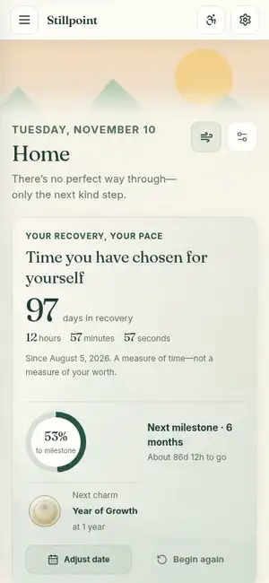
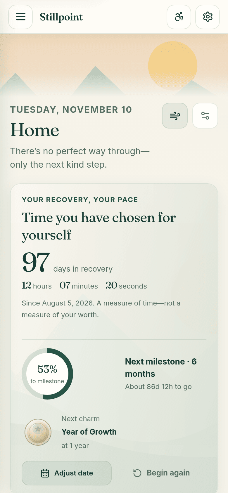
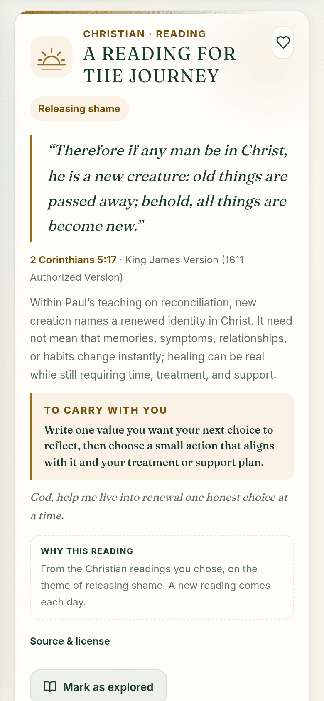
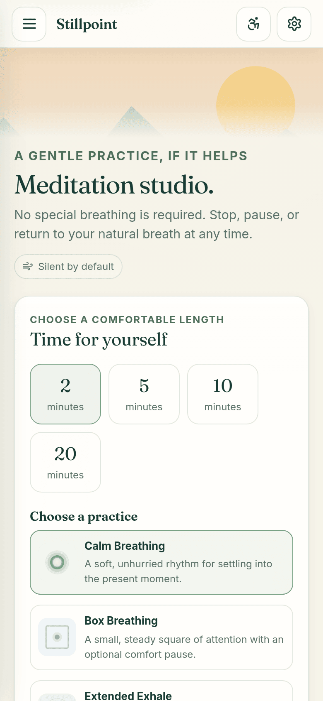
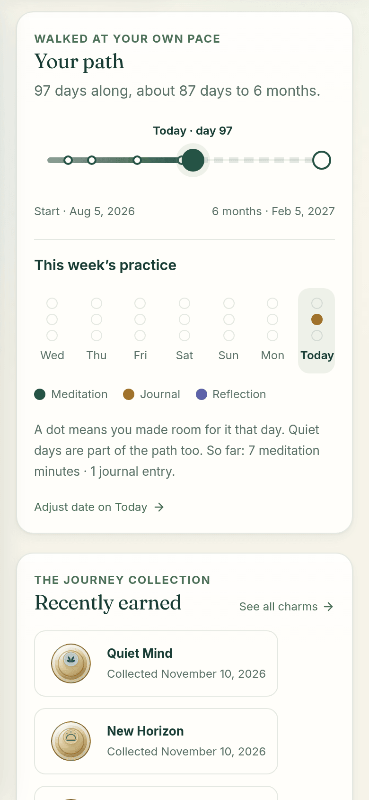
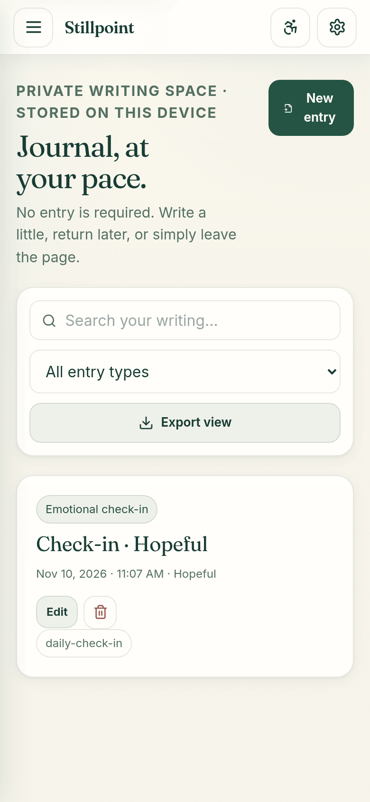
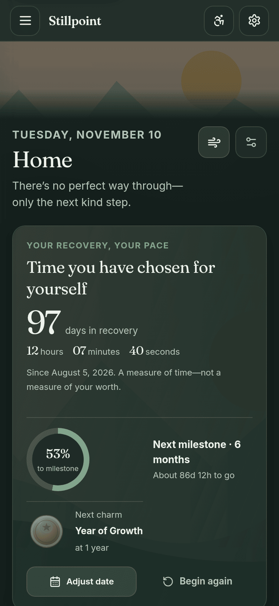

# Stillpoint Recovery: a one-page overview for programs and funders

**A private, faith-friendly recovery companion. Free, open source, no accounts. Data stays on the person's phone.**

Live app: <https://stillpoint-recovery.vercel.app/> · Source: <https://github.com/mcochranca-code/stillpoint-recovery>

## The problem

People in recovery are often asked to hand over personal information to get support: an account, an email address, a phone number, a story. Many recovery apps also turn recovery into a score, with streaks that "break" and leave a person feeling they have failed. For someone already carrying shame, both can be reasons to stop using a tool. Programs that want to recommend a daily companion face a second problem: anything that collects participant data brings privacy, consent, and procurement work with it.

## What Stillpoint is

Stillpoint is a web app that installs on a phone like a regular app. It offers daily readings, gentle meditation, a private journal, a short "I need a moment" pause, and a calm view of progress. It asks for nothing to get started: no account, no email, and not even a recovery date. Everything a person writes or records is kept in the browser on their own device.

It is a personal reflection companion. It is **not** medical care, treatment, diagnosis, or an emergency service, and it does not replace professional or peer support.

## Key features

- **Readings from seven traditions,** chosen by the person: Christian, Buddhist, Hindu, Muslim, Jain, Red Road (Native wellbriety), and Spiritual but not religious. One, a few in turn, or all in rotation. Nothing is preselected, and a Faith-neutral preset hides Scripture-specific sections.
- **90 original daily reflections,** each with a principle, a small practice, and a question to carry, plus a link to the official NA *Just for Today* reading.
- **No streak pressure.** Progress is a gentle path to the next milestone with a week of practice shown as dots. A missed day breaks nothing. Twelve illustrated milestone charms mark the way.
- **"I need a moment":** a 90-second pause with breathing, grounding, writing, a short prayer, or a look at the person's own trusted contacts. It is plain that it is a pause, not a promise, and points to emergency services when needed.
- **Meditation studio:** ten gentle practices in 2, 5, 10, or 20 minutes, with pause, resume, and three bundled soundscapes.
- **Private journal** with search, drafts, and editing.
- **Meeting samples:** an offline, source-linked, partial sample of public AA/NA meetings in Stanislaus, Fresno, Mariposa, and Merced counties, with an optional map.
- **Works offline** once installed, and supports on-device backup and restore.
- **A built-in walkthrough:** a short, silent, self-hosted tour on the welcome screen and in Settings, with a text description and Play/Pause control.

## Privacy

- No account, no cloud sync, no ads, no analytics.
- Journals, dates, readings, sessions, charms, and settings stay in the browser on the device. Programs never receive participant data, because Stillpoint never collects it.
- What can leave the device, only by the person's choice: optional community notes (off by default; short public notes of 120 characters or fewer, kept up to 90 days, with no profile, date, journal, or location attached); map tiles from OpenStreetMap when the optional map is opened; and normal page visits when the person clicks an outside link. The map's "Show my approximate position" button uses the phone's location only when pressed, keeps it on that page, and never sends it to Stillpoint.
- Honest limits: browser storage and backups are not encrypted, and clearing browser data can erase saved entries. People should export a backup and keep it somewhere private.

Full detail: [Our privacy promise](../../README.md#our-privacy-promise) and the [Data and Privacy guide](../wiki/Data-and-Privacy.md).

## Accessibility

Reduced motion, high contrast, adjustable text size (85% to 130%), dark appearance, discreet mode, full keyboard access, and labelled controls with text equivalents for visuals, so it works with screen readers. Automated accessibility (axe) and color-contrast checks run with the test suite, and a Lighthouse accessibility check runs in CI on every pull request and on pushes to main.

## See it in motion

A 30-second silent walkthrough is also built into the app (welcome screen, and Settings → Take the tour), so staff can show participants around without a video site. It is served by Stillpoint itself, with no YouTube embed, no tracking, and a text description of each step. It never plays by itself when Reduced motion is on.

## Screenshots

| Today | Your reading | Meditation |
| --- | --- | --- |
|  |  |  |

| Your path | Private journal | Dark appearance |
| --- | --- | --- |
|  |  |  |

Screens use illustrative sample values. No personal recovery information is shown.

## Cost

- **Free** to use, with no accounts, subscriptions, or per-seat fees.
- **Open source** under the [MIT License](../../LICENSE). Programs may run their own copy. (The app also includes an optional NA Step Working Guides reader. It is opt-in, off by default, and for personal use on each person's own device only; the text is © NA World Services, shown by permission, and excluded from the MIT License. Answers stay on the device and are never uploaded or shared. See the README.)
- **Nothing to procure or administer:** no participant accounts and no participant data to store.

## How to pilot it

1. **Try it yourself first.** Open the live app on a phone, install it, and spend a few days with it.
2. **Share the link.** Give participants <https://stillpoint-recovery.vercel.app/> and the install steps: iPhone Safari → Share → Add to Home Screen; Android Chrome → ⋮ menu → Install app.
3. **Set expectations.** Tell people it is private, optional, and not a crisis service, and show them how to export a backup.
4. **Gather feedback without collecting data.** Ask participants in person or through your own program surveys. The app does not report usage to anyone.
5. **Tell us what you need.** Open an issue at <https://github.com/mcochranca-code/stillpoint-recovery/issues> with feedback, meeting-list corrections for your area, or content requests.

Stillpoint is not affiliated with Narcotics Anonymous World Services, Our Daily Bread Ministries, or any fellowship.
