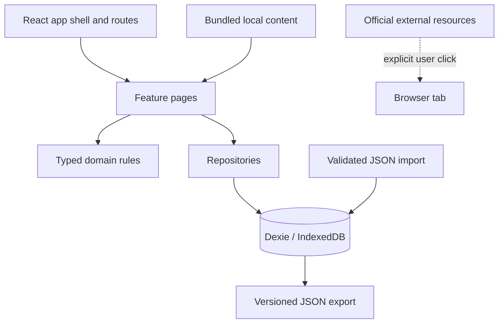

# Architecture

Stillpoint is a client-only React + TypeScript + Vite application. The browser is the system of record; there is no application backend or managed database in the core experience.

## Source boundaries

- `src/app/` contains the provider, onboarding, navigation, lazy route loading, and dialog focus behavior.
- `src/features/` contains Today, Progress, Journal, Meditation, Library, Settings, Reset, Garden, and Field Guide experiences.
- `src/components/` contains reusable cards, forms, dialogs, audio controls, and sharing UI.
- `src/db/` contains the Dexie schema, migrations, repositories, milestones, backup validation, import, and deletion.
- `src/domain/` contains date policy, timer math, achievement criteria, presentation helpers, and share payload rules.
- `src/data/` contains local reflections, scripture entries, exercises, themes, and charm definitions.
- `public/` contains static brand assets, soundscapes, the PWA manifest, service worker, and declared routes.

## Routes

The app shell lazy-loads these routes:

- `/` — Today dashboard.
- `/progress` — activity, milestones, goals, and Journey Collection.
- `/journal` — private entries, search, editing, and draft recovery.
- `/meditation` — exercises, timer controls, local soundscapes, and history.
- `/library` — reflections, scripture, practices, and collection browsing.
- `/reset` — the brief “I need a moment” support flow.
- `/garden` — visual, non-punitive growth from supportive activity.
- `/field-guide` — user-built coping notes and strategies.
- `/settings` — accessibility, privacy, reminders, backup, restore, and deletion.

The router redirects unknown paths to `/`.
