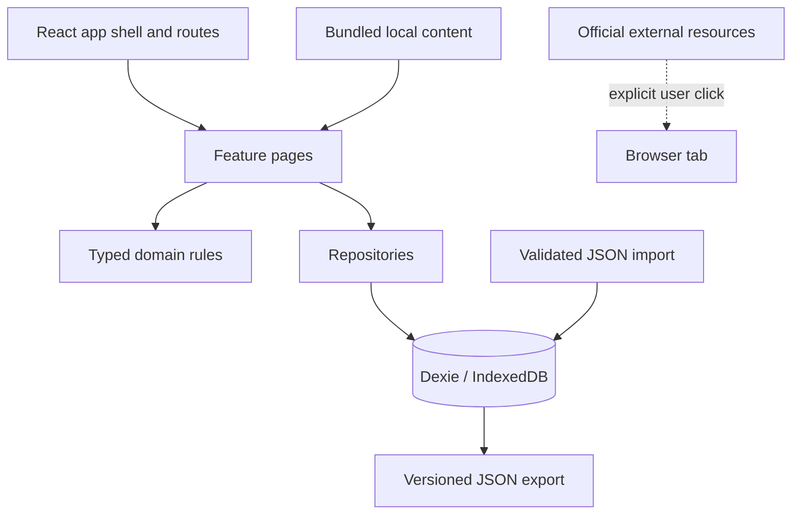

# Architecture

Stillpoint is a client-only React + TypeScript + Vite application. The browser is the system of record; there is no application backend or managed database in the core experience.

## Source boundaries

- `src/app/` contains the provider, onboarding, navigation, lazy route loading, and dialog focus behavior.
- `src/features/` contains Today, Progress, Journal, Meditation, Meetings, optional Community Notes, Library, Settings, Reset, Garden, and Field Guide experiences.
- `src/components/` contains reusable cards, forms, dialogs, audio controls, and sharing UI.
- `src/db/` contains the Dexie schema, migrations, repositories, milestones, backup validation, import, and deletion.
- `src/domain/` contains date policy, timer math, achievement criteria, presentation helpers, and share payload rules.
- `src/data/` contains local reflections, scripture entries, exercises, themes, charm definitions, and dated AA/NA/FA/SMART/Faith-Based meeting snapshots, with county coverage and source notes for Fresno, Merced, Mariposa, and the user-supplied Faith-Based dataset.
- `public/` contains static brand assets, soundscapes, the PWA manifest, service worker, and declared routes.

## Ownership boundaries

- **Feature UI (`src/features/`, `src/components/`)** owns presentation, interaction state, and accessible user feedback. It may call domain functions and typed repository APIs; it should not define persistence schema or duplicate domain policy.
- **Domain (`src/domain/`)** owns deterministic rules, validation policy shared across views, time calculations, and privacy-limited payload shaping. It stays independent of React and browser rendering.
- **Persistence (`src/db/`)** owns Dexie schema versions, IndexedDB migrations, record repositories, backup validation, and transactional restore. Schema changes require a new version, an additive migration, migration tests from supported predecessors, and a rollback/recovery note.
- **Bundled data (`src/data/`)** owns local content and source/provenance notes. External fetches and user-specific filters do not belong in static datasets.
- **Platform/app shell (`src/platform/`, `src/app/`, `public/`)** owns browser capabilities, routing, initialization, and PWA caching. Optional platform behavior must have a supported fallback.

Cross-feature behavior should be expressed through domain rules or a narrow shared repository contract. Avoid feature-to-feature imports and avoid placing personal data in global browser storage, URLs, telemetry, or external requests. See [ADRs](../adr/README.md) for accepted architectural decisions and [Data and Privacy](Data-and-Privacy.md) for storage risks.

## Routes

The app shell lazy-loads these routes:

- `/` — Today dashboard.
- `/progress` — activity, milestones, goals, and Journey Collection.
- `/journal` — private entries, search, editing, and draft recovery.
- `/meditation` — exercises, timer controls, phase-synchronized Box Breathing orb, local soundscapes, and history.
- `/meetings` — offline AA/NA/FA/SMART/Faith-Based directory snapshots with fellowship, county/source region, weekday, city, format, and text filters, source links where available, and explicit unverified provenance for Faith-Based demo rows.
- `/community` — optional account-free Community Notes board. It is off by default and appears in navigation only after the local opt-in is enabled; public notes are fetched only after opening the board.
- `/library` — reflections, scripture, practices, and collection browsing.
- `/reset` — the brief “I need a moment” support flow.
- `/garden` — visual, non-punitive growth from supportive activity.
- `/field-guide` — user-built coping notes and strategies.
- `/settings` — accessibility, privacy, reminders, backup, restore, and deletion.

The mobile shell uses a hamburger menu for primary destinations while keeping a pinned Settings and privacy icon available at all times. Desktop navigation has its own collapsible icon rail. Both controls are local UI state and do not leave the browser.

Meeting filters run entirely on the bundled snapshots. No location permission or attendance tracking is used; official schedule and map links open only after an explicit click. Coverage notes distinguish bundled records from partial or dynamic official directories instead of implying that an incomplete snapshot is exhaustive.

The router redirects unknown paths to `/`.
